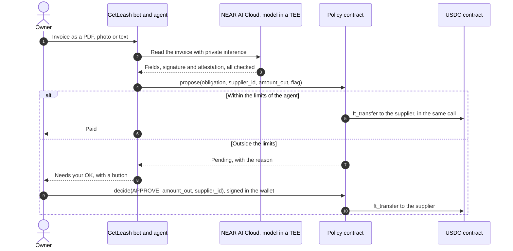
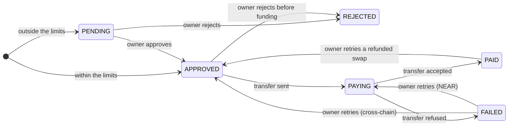
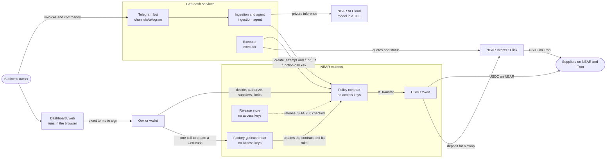
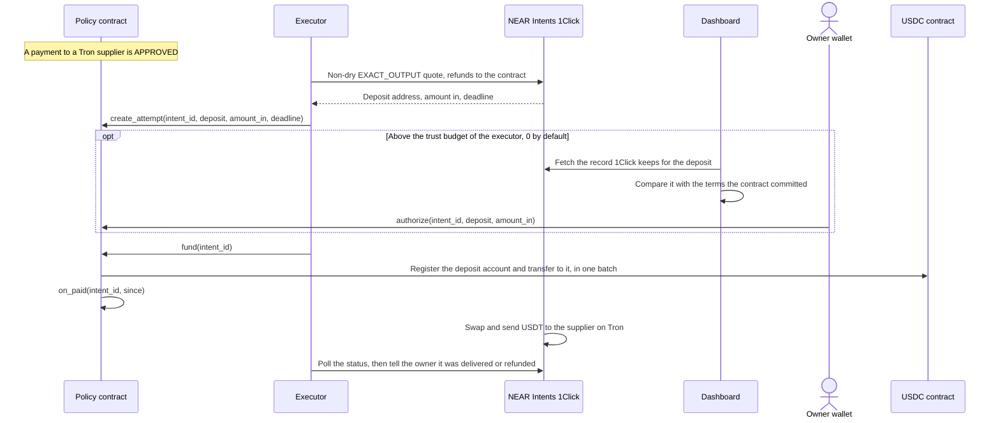
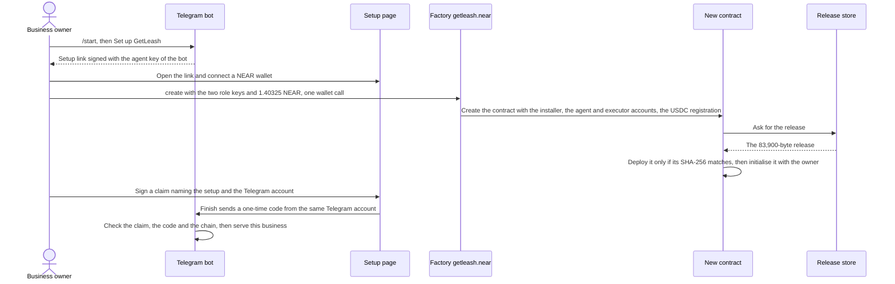
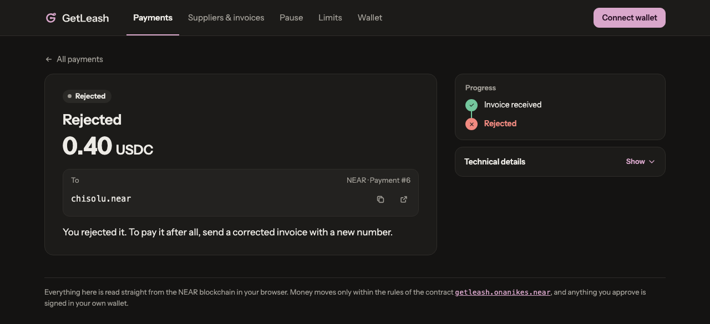
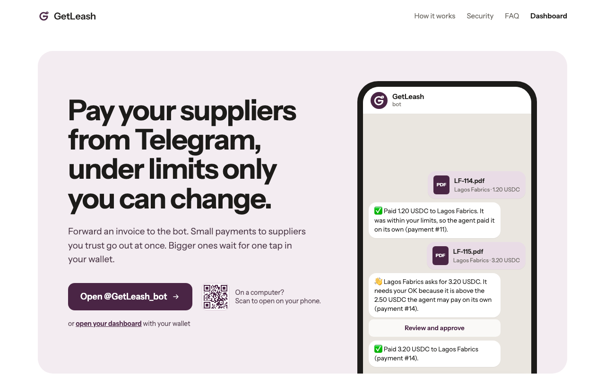

<h1 align="center">
  <picture>
    <source media="(prefers-color-scheme: dark)" srcset="web/public/logo-dark.svg">
    
  </picture>
</h1>

<p align="center"><strong>An accounts-payable agent in Telegram: it reads a business's supplier invoices and proposes the payments; a NEAR contract that only the owner's wallet controls decides and pays.</strong></p>

<p align="center">
  <a href="https://www.getleash.xyz">Website and dashboard</a> ·
  <a href="https://t.me/GetLeash_bot">Telegram bot</a> ·
  <a href="https://youtu.be/FJgs8wseBbk">Demo video (1:41)</a> ·
  <a href="https://x.com/usegetleash/status/2118637512897831054">Demo post on X</a>
</p>

- **[Live on NEAR mainnet](#live-on-near-mainnet) since 2 Nov 2026, so far tried by the team itself.** Its own
  GetLeash, [`getleash.onanikes.near`](https://www.getleash.xyz/payments?c=getleash.onanikes.near), has paid five
  invoices (1.95 USDC; one, sent as a PDF, inside the agent's own call), and on 7 Nov two attacks on it paid nothing.
  A business sets up its own from the bot with one wallet call to the keyless factory `getleash.near`, about 1.43 NEAR
  once; the team's test wallet did, creating `onasachi-tg.getleash.near`.
- **Cross-chain payouts** (USDT on Tron through NEAR Intents 1Click) are built and tested on a local node and on
  testnet with mock 1Click; none has been made on mainnet yet.
- **Built at the NEAR Hackathon** (1–14 Nov 2026), all code in that window ([history](#tools-and-ai-assistance)),
  for the tracks `security`, `business`, `realworld`, `privacy`, `agents` and `open` ([how each fits](#hackathon-tracks)).

| What it does beyond caps and an allowlist | Where to see it |
|---|---|
| **The agent never supplies an address.** It names a supplier from the owner's list, paid at the address on file, never one an invoice gives. No model text reaches the chain. | Mainnet, 7 Nov, nothing paid: an invoice from a supplier not on file, whose note told the AI the owner had pre-approved it, refused on-chain (`UNKNOWN_SUPPLIER`); one in a listed supplier's name asking to be paid at a new wallet, held (`ADDRESS_MISMATCH`) and rejected by the owner |
| **Changed payment details wait, even for the owner.** For 2 days after a supplier is added or its details change, every payment to it waits for the owner, whose own approval is capped at 0.50 USDC a payment (`OVER_COOLDOWN_MAX`) unless they first change the limits. | Mainnet, 3–5 Nov: four payments held in the cooldown, then approved by the owner; `pnpm demo:mock`: `even the owner cannot approve more than 0.50` |
| **One payment per invoice.** Its id is a keyed HMAC-SHA256 of the supplier and the normalised invoice number, so the same invoice in another format gets the same id. | Mainnet, 6 Nov: a PDF invoice paid inside the agent's own call, refused when sent again (`OBLIGATION_OPEN_OR_PAID`); `pnpm demo:mock` refuses a reformatted copy |
| **The owner signs exact terms.** `decide` repeats the amount and the supplier; `authorize` names the exact 1Click deposit address and amount. Anything else is refused (`TERMS_MISMATCH`). | Before a cross-chain signature, the dashboard checks 1Click's record of the deposit against 12 fields: the contract's terms and the required quote settings (`pnpm devnet`) |
| **Keyless, hash-pinned contracts.** The treasury, the factory and the release store have no access keys; the installer deploys only the release whose SHA-256 is built into it, and the release rebuilds reproducibly. No key GetLeash holds can withdraw, add a supplier or change a limit. | The second command below; `onasachi-tg.getleash.near`, made by the factory, has 0 access keys and the release's code hash; [step 7](#run-it-locally) rebuilds the release |
| **Private reading that gates autonomy.** A model in a TEE on NEAR AI Cloud reads invoices. A reply counts as verified only after its signature, Intel TDX quote and NVIDIA GPU attestation check out; one whose checks fail loses the agent's autonomy, so its payment waits for the owner (D-35). This proves where the inference ran, not that the invoice is genuine. | 2 Nov: all 13 fixture invoices read by `Qwen/Qwen3.8-27B`, each "Model response verified" (`agent/src/verify.ts`, `agent/src/rules.ts`) |
| **Other AI agents can use it.** Over MCP an assistant can read a GetLeash contract and, on the owner's machine with the agent's key, hand it invoices. It can't name a supplier, an address or an amount, and the contract still decides. | The third command below, on https://www.getleash.xyz/mcp (read-only); [From an AI assistant (MCP)](#from-an-ai-assistant-mcp) |
| **What it does not stop.** A fabricated small invoice from a listed supplier is paid if it fits the limits. | The agent's daily budget bounds it: in `pnpm demo:mock` the first is paid, the next waits (`AUTONOMOUS_BUDGET_USED`) |

**Check it in a minute, with no clone, wallet or key** (NearBlocks answers HTTP 403 to scripts and AI fetchers, and
the dashboard needs a browser):

```bash
# 1. Payment 5 on an archival node: intent_created (AUTONOMOUS), paying to chisolu.near, ft_transfer 250000, payout PAID
curl -s https://archival-rpc.mainnet.fastnear.com -H 'Content-Type: application/json' \
  -d '{"jsonrpc":"2.0","id":0,"method":"tx","params":{"tx_hash":"6pBLAr4zhk6m4bCE6uPEdjAJDQcUgWcbM2WLbX5Bco2X","sender_account_id":"agent-1.onanikes.near"}}' \
  | jq '.result | {status, logs: [.receipts_outcome[].outcome.logs[]]}'
# 2. The treasury's access keys → []  (for agent-1.onanikes.near: one key, method_names ["propose"])
curl -s https://rpc.mainnet.fastnear.com -H 'Content-Type: application/json' \
  -d '{"jsonrpc":"2.0","id":0,"method":"query","params":{"request_type":"view_access_key_list","finality":"final","account_id":"getleash.onanikes.near"}}' \
  | jq '.result.keys'
# 3. The hosted MCP server → text starting "getleash.onanikes.near on mainnet: payments are on."
curl -s https://www.getleash.xyz/mcp -H 'content-type: application/json' -H 'accept: application/json, text/event-stream' \
  -d '{"jsonrpc":"2.0","id":1,"method":"tools/call","params":{"name":"get_policy","arguments":{}}}'
```

With `"tx_hash":"GUpgQAMnrjbyf95TNzexxtWLk5SSz7WCEfwaBwDnrB5X"` (7 Nov), the first command shows `proposal_refused`
with reason `UNKNOWN_SUPPLIER`.

**Tested:** 47 Rust tests, including random walks over the whole contract that check, day by day, that outflow stays
within the daily cap, the agent's own approvals within its budget and unsigned executor funding within its trust
budget, and that nothing is paid twice without an owner's retry; 46 tests on a local NEAR node; 198 TypeScript tests;
and an offline demo of 14 steps over 13 invoices, attacks included. See [Quick verify](#quick-verify).

## Contents

- [The problem](#the-problem) · [The solution](#the-solution) · [How a payment works](#how-a-payment-works)
- [Architecture](#architecture) · [Security model](#security-model) · [Privacy](#privacy)
- [Hackathon tracks](#hackathon-tracks) · [Live on NEAR mainnet](#live-on-near-mainnet) · [Quick verify](#quick-verify)
- [Try the live product](#try-the-live-product) · [From an AI assistant (MCP)](#from-an-ai-assistant-mcp) · [Run it locally](#run-it-locally) · [Deploy your own](#deploy-your-own)
- [Repository layout](#repository-layout) · [Tech stack](#tech-stack) · [Limitations and non-goals](#limitations-and-non-goals)
- [Documentation](#documentation) · [Tools and AI assistance](#tools-and-ai-assistance) · [License](#license)

## The problem

A small importer pays suppliers in USDC on NEAR and USDT on Tron.

- **Paying by hand is slow.** Someone reads each invoice, finds the supplier's payment details, copies an
  address and an amount into a wallet, and checks them twice.
- **Invoices are a fraud target.** Fake invoices and swapped bank or wallet details are common, and a changed
  address on an otherwise ordinary invoice is easy to miss.
- **An AI agent with a wallet fixes the speed and makes the fraud worse.** An agent that holds a key pays
  whatever it is talked into: one prompt injection hidden in an invoice, one model mistake or one stolen
  server key, and the money is gone. Limits written into the agent's own code don't help, because the agent
  is the part that gets compromised.

## The solution

GetLeash separates reading invoices from moving money. The agent reads and proposes; a contract that only the
owner's wallet controls decides and pays.

| Principle | How GetLeash does it |
|---|---|
| The money sits in the business's own contract | A NEAR policy contract with **no access keys** holds the USDC. Only the owner's wallet can add suppliers, change limits, pause, withdraw or upgrade it. |
| The agent can only propose | Its account holds one function-call key that can call `propose` and nothing else. It never supplies an address: it names a supplier from the owner's list. |
| The contract enforces the limits | A USDC payment within the limits is sent in the agent's own call. Anything above the approval threshold, past the agent's daily budget or the daily cap, or to a supplier added or changed in the last 2 days waits for the owner. |
| The owner approves exact terms | A button in Telegram opens the payment page. The wallet signs `decide`, which repeats the payment's amount and supplier, or `authorize`, which names the exact 1Click deposit address and amount. |
| Invoices are read privately | A model in a TEE on NEAR AI Cloud reads them. A response counts as verified only after its Intel TDX and NVIDIA GPU attestation checks out. |
| Payouts can cross chains | USDT on Tron goes through NEAR Intents 1Click. The contract funds only a deposit the owner signed, or one within an opt-in executor trust budget (0 by default). |
| Any business can start from a chat | `/start` in Telegram, then one wallet call to the keyless factory `getleash.near` creates the business's own keyless contract, for about 1.43 NEAR once. |

**For the owner, it all happens in Telegram.** Forward an invoice (a PDF, a photo or pasted text) and the bot
answers that it was paid, or that it needs your OK, with a button. The bot's commands:

| Command | What it does |
|---|---|
| `/start` | The welcome, with the button to set up your own GetLeash |
| `/pending` | Payments waiting for you |
| `/status` | Your treasury and what was spent today |
| `/limits` | Your limits, and a button to change them |
| `/suppliers` | Who can be paid |
| `/addsupplier` | Add someone you pay, for example `/addsupplier Acme acme.near` |
| `/invite` | Ask a supplier to send their payment details, through a one-time link |
| `/wallet` | Set up the wallet you approve payments with |
| `/pause` | Stop every payment at once |
| `/help` | What the bot can do |

## How a payment works



1. **An invoice arrives.** The owner sends the bot a PDF, a photo or pasted text. Ingestion caps sizes,
   processes each Telegram update once, and reads a PDF's text layer in a process of its own, which gets no
   secrets (D-33).
2. **The agent reads it on NEAR AI Cloud.** A model in a TEE (`Qwen/Qwen3.8-27B` on the live bot) extracts
   the supplier's name, the invoice number, currency, total, due date and payment details. The agent then
   checks the response's signature and the TEE's attestation ([Privacy](#privacy)).
3. **Deterministic code builds the proposal.** The supplier is matched against the owner's directory, and the
   payment always goes to the address on file, never to one an invoice gives. The amount is the total the
   model read; it must appear in the invoice's text, or the payment is flagged for review
   (`AMBIGUOUS_EXTRACTION`). For a photo, that text is the model's own transcription. The invoice number must be
   in the text too, or the invoice waits for the owner. The obligation id is an HMAC-SHA256 of the supplier
   and the normalised invoice number under the business's secret, so the same invoice sent again in another
   format gets the same id. No model text reaches the chain: the agent sends the supplier's id, the amount, the
   obligation id and at most one enum review flag (`ADDRESS_MISMATCH`, `UNCERTAIN_MATCH`,
   `AMBIGUOUS_EXTRACTION`, `UNUSUAL_AMOUNT`), which can only force review. An invoice from an unknown supplier
   is proposed as supplier 0, which the contract
   refuses (docs/decisions.md D-20).
4. **The agent calls `propose(obligation, supplier_id, amount_out, flag)`** and the contract decides, as in
   the table below. A USDC payment on NEAR within the agent's limits is sent in that same call.
5. **The owner decides what waits.** The bot sends a button that opens the payment page, which says who gets
   what and why it needs the owner. The wallet signs `decide`, which repeats the payment's amount and supplier.
   Every owner call attaches 1 yoctoNEAR, so the wallet always asks. A rejected invoice stays blocked (D-07).
6. **The transfer settles.** Every payout goes through one function, `start_payout`: all checks, then the
   state change, then the transfer. The callback `on_paid(intent_id, since)` records the result. It never
   panics, and it does nothing unless that payout is still `PAYING` with the same `since`. If no callback
   comes back within an hour, the owner can mark the payout paid or failed.

**What the contract does with a proposal** (`contract/src/agent.rs`, `contract/src/rules.rs`):

| The contract | When | Codes |
|---|---|---|
| **refuses** it: no payment is stored | the supplier isn't on the owner's list or is inactive; the invoice is already open, paid or rejected; the contract is paused; storage is full; the amount is invalid | `UNKNOWN_SUPPLIER`, `INACTIVE_SUPPLIER`, `OBLIGATION_OPEN_OR_PAID`, `OBLIGATION_REJECTED`, `PAUSED`, `STORAGE_FULL`, `BAD_AMOUNT` |
| **holds** it for the owner (`PENDING`) | the first that applies, in this order: a review flag; the supplier was added or changed less than 2 days ago; the amount is above the approval threshold; the payment would take the agent's daily budget, or the daily cap, over its limit (a cross-chain payment counts with its fee allowance) | `REVIEW_FLAG`, `SUPPLIER_COOLDOWN`, `ABOVE_THRESHOLD`, `AUTONOMOUS_BUDGET_USED`, `DAILY_CAP` |
| **approves** it on its own (`AUTONOMOUS`) | none of the above | USDC on NEAR is paid in the same call; a cross-chain payment waits for the executor's quote (`APPROVED`) |

A call from any account but the agent fails (`ONLY_AGENT`), and so does a 21st proposal in one UTC day
(`QUOTA_PROPOSALS`), before anything is written; a refused proposal still counts toward the 20. Even the owner can approve at most 0.50 USDC to a supplier in
its cooldown (`OVER_COOLDOWN_MAX`), and the daily cap bounds every approval.

**The default limits.** Every business set up from the bot starts with these (`DEFAULT_POLICY` in
`shared/src/setup.ts`), and so does the team's mainnet contract (`deploy/mainnet-policy.json`, one tenth of
v1's defaults). The owner changes them with `/limits` or the dashboard's Limits page; `set_policy` checks every
change.

| Limit | Default | Meaning |
|---|---|---|
| Approval threshold | 2.50 USDC | The largest payment the contract approves without the owner |
| Agent's daily budget | 5.00 USDC | The most the contract pays without the owner in a UTC day |
| Daily cap | 20.00 USDC | The most that can leave in a UTC day, the owner's approvals included |
| Cooldown | 2 days | After a supplier is added or its payment details change, every payment to it waits for the owner |
| Most the owner can approve during a cooldown | 0.50 USDC | Enough for a test payment |
| Executor trust budget | 0 USDC | Cross-chain deposits the executor may fund without the owner's signature, per day |
| Cross-chain fee bound | 1% + 1.50 USDC | The most a quote may cost on top of the payment's value |
| Expiry | 3 days | A payment not made by then can no longer be paid |
| Proposals | 20 a day | The agent's proposals per UTC day |
| Retention | 7 days | Closed payments are kept this long, then can be removed to free storage |

**A payment's life** (`contract/src/types.rs`, `Status`):



A USDC payment on NEAR never rests in `APPROVED`: it is paid in the call that approves it. A retry charges the
budgets again. Budget counters only go up within a day, so failed transfers, refunds and returned change never
give budget back. At most 50 payments are stored at once; closed ones can be removed after the retention time,
and never-funded expired ones at once.

## Architecture



### Components

| Component | Code | What it does | Keys it holds |
|---|---|---|---|
| Policy contract | `contract/`: Rust, near-sdk 5.29, an 83,900-byte release | Holds the USDC and the supplier list, enforces the limits, decides and sends every payment | None: the account has no access keys |
| Factory | `contract/bootstrap/factory`: raw wasm, 7,921 bytes, at `getleash.near` | Creates a business's contract, its two role accounts and its USDC registration in one wallet call | None |
| Installer and release store | `contract/bootstrap/`: 1,932 and 1,368 bytes | The installer copies the release from the store and deploys it only if its SHA-256 is the release's | None |
| Agent | `agent/`, `ingestion/`: TypeScript | Reads invoices on NEAR AI Cloud, checks the TEE evidence, matches the supplier, computes the obligation id, calls `propose` | One function-call key: `propose` on its business's contract |
| Executor | `executor/`: TypeScript, no LLM | Quotes cross-chain payouts on 1Click, records and funds deposits, tells the owner what was delivered or refunded | One function-call key: `create_attempt`, `fund` and `forget` |
| Telegram bot | `channels/telegram/`: grammY | The owner's interface: invoices, approvals, suppliers, limits, setup and notices; it runs the agent | The agent's key; for businesses it hosts (D-30), their agent and executor keys |
| MCP server | `channels/mcp/`: MCP TypeScript SDK; stdio on the owner's machine, and read-only at https://www.getleash.xyz/mcp (`web/app/mcp`) (D-34) | Lets an AI assistant read a contract's limits, payments and suppliers, and on the owner's machine hand invoices to the bot's pipeline | The hosted one: none. The local one: none for reading; to take invoices, the agent's key |
| Dashboard | `web/`: Next.js | The landing page and the dashboard. It reads the chain from the owner's browser, prepares every owner signature, and checks 1Click's record before a cross-chain one | None: the owner's wallet signs |
| Shared library | `shared/` | Borsh types and strict decoders (golden vectors shared with Rust), role-scoped clients, the 1Click client, the setup flow, address checks | — |

### Accounts and keys

| Account | Keys | What it can do |
|---|---|---|
| The owner's wallet | Full access, in the owner's wallet | Every owner method: `decide`, `authorize`, suppliers, limits, pause, roles, withdrawals, `upgrade`. Each attaches 1 yoctoNEAR, so the wallet asks every time |
| The policy contract: `<name>.getleash.near` from the bot, `getleash.<owner>` from the CLI | None | Only run its own code. Its code changes only through the owner-signed `upgrade` |
| The agent: `<name>-agent.getleash.near`, or `agent-1.<owner>` | One function-call key, for `propose` on that contract | Propose payments to listed suppliers. The protocol refuses this key for transfers, deposits, other methods and other contracts |
| The executor: `<name>-executor.getleash.near`, or `executor-1.<owner>` | One function-call key, for `create_attempt`, `fund` and `forget` | Quote and fund the cross-chain payouts the contract allows |
| The factory `getleash.near` and the release store `release-8eaccbf1.onanikes.near` | None | Create a new business's accounts; serve the release. Neither can change a contract once it exists |

`<name>` is the owner's account id with dots made dashes: `onasachi.tg` gets `onasachi-tg.getleash.near`.

### Contract interface

| Caller | Method | Arguments | Notes |
|---|---|---|---|
| Agent | `propose` | Borsh: obligation, supplier_id, amount_out, flag | Wrong caller or quota: fails before any write. Refusals store nothing |
| Executor | `create_attempt` | Borsh: intent_id, deposit, amount_in, deadline | Cross-chain only; replaces an unfunded attempt, never with the same deposit |
| Executor | `fund` | Borsh: intent_id only | Pays an attempt the owner authorized, or a current-epoch one within the trust budget |
| Executor or owner | `forget` | Borsh: intent ids | Removes closed payments after the retention time, and never-funded expired ones |
| Owner | `decide` | JSON: intent_id, action, amount_out, supplier_id | `APPROVE`, `REJECT`, `RETRY`, `MARK_PAID`, `MARK_FAILED`; the terms must match the payment's (`TERMS_MISMATCH`) |
| Owner | `authorize` | JSON: intent_id, deposit, amount_in | Signs one exact 1Click deposit and amount |
| Owner | `add_supplier`, `update_supplier`, `set_supplier_active` | JSON | Adding or changing a supplier starts its cooldown; a change bumps its revision, so open payments to the old details can't pay |
| Owner | `set_policy`, `set_paused`, `set_roles` | JSON | `set_policy` checks the limits; a new executor (`set_roles`) voids the old one's unsigned attempts (D-19) |
| Owner | `withdraw`, `withdraw_near`, `upgrade` | JSON; code for `upgrade` | `upgrade` is refused while a payout is in flight |
| The contract itself | `on_paid(intent_id, since)` | private callback | Never panics; its arguments never change across upgrades |
| Anyone | `get_state`, `get_suppliers`, `get_intents` | Borsh views | The dashboard decodes them with the strict decoders in `shared/src/types.ts` |

### Cross-chain payouts



The executor has no model. It asks 1Click for a non-dry `EXACT_OUTPUT` quote with `depositType=ORIGIN_CHAIN`,
`recipientType=DESTINATION_CHAIN`, `refundType=ORIGIN_CHAIN` and refunds to the contract, records the quote's
deposit with `create_attempt`, and funds it with `fund(intent_id)`, which takes only an id. The contract checks
the fee bound and the quote's deadline, and sends the deposit only if the owner signed that exact deposit and
amount, or if it fits the executor's daily trust budget, the attempt belongs to the current executor and the
supplier is not in its cooldown (`COOLDOWN_NEEDS_OWNER`).
Before the owner signs, the dashboard fetches 1Click's own record of the deposit address and checks it against
12 fields (the contract's terms and the required quote settings), and that no other payment uses the address. The payout is one receipt to
USDC that registers the deposit account and transfers to it, so a failed transfer also undoes the
registration. A refund lands back in the treasury as USDC, and the owner can retry the payment.

### Setting up a business from Telegram



The wallet signs one call, `create({"agent":"<hex>","executor":"<hex>"})` on `getleash.near`, with exactly
1.40325 NEAR attached: 1.40 for the three new accounts, 0.00125 for the USDC registration and 0.002 that the
factory keeps for its record. For the caller as owner, the factory creates `<name>.getleash.near` with a
1,932-byte installer, `<name>-agent` and `<name>-executor` with one function-call key each (keys the bot
generated), and the contract's USDC registration. The installer copies the release from the store, deploys it
only if its SHA-256 is the release's, and initialises it with the caller as owner and the default limits.
About 1.43 NEAR leaves the wallet in all; the page asks for about 1.491 while the wallet signs, because NEAR
holds the attached gas until the call ends. The factory refuses a name it set up before, a name ending like a
role account's, a wrong deposit or malformed keys, all before anything is spent (D-32).

The bot serves the new business only when its contract checks out on-chain (the release's code hash, no keys,
the owner, the roles with only their keys, USDC), the owner's wallet has signed a claim naming the setup and
their Telegram account, and a one-time code has come from that same Telegram account. A lookalike bot that
sends someone to the real page gets the claim but never the code, and a forwarded link fails the same way. The
owner's wallet can move its GetLeash to another Telegram account at any time. HOT Wallet shows the factory call
without a warning, where a deployment or a new key in the wallet's own request would be a "dangerous request"
to type CONFIRM for (D-32).

### Design decisions

- **A lean contract** (D-28). v1 kept full accounting on-chain and compiled to 370,399 bytes, about 3.7 NEAR of
  storage. v2 keeps the guarantees and moves bookkeeping (reconciliation, delivery reports, the open-work list)
  to the services; its release is 83,900 bytes. Contract code has no `format!`, `unwrap`, `serde_json` or
  `near_sdk::store`, and a test fails above 150 KB.
- **Owner calls a wallet can show.** Owner methods take flat JSON read by a strict parser
  (`contract/src/json.rs`, property-tested against serde_json), so the wallet shows exactly what is signed.
  Machine callers and views use Borsh, with layouts pinned by golden vectors shared with TypeScript.
- **Pure rules.** `contract/src/rules.rs` and `contract/src/budget.rs` make no `env::` calls, so they are
  property-tested on their own, and random walks over the whole contract check its invariants.
- **A factory, not a deployment in the wallet** (D-31, D-32). HOT Wallet's connector could not carry the 84 KB
  release (D-31), and HOT Wallet flags any deployment as a dangerous request.
- **Only NEAR-hosted models, and a precise badge** (D-24). "Model response verified" says where the inference
  ran, nothing more.
- **Private data stays where the services run** (D-26).

## Security model

### What the contract guarantees

- **No keys on the treasury.** The contract account has no access keys. Its code changes only through the
  owner-signed `upgrade`, which is refused while a payout is in flight, or once, at creation, through the
  installer, which installs only the release whose SHA-256 is built into it.
- **One path for money.** Every payout goes through `start_payout`: all checks, then the state change, then the
  transfer. `fund` takes only an intent id; nothing that moves money takes an amount, receiver or address
  from the executor.
- **Only listed suppliers, at their current details.** A payment records the supplier's id and revision.
  Changing a supplier bumps its revision, so open payments to the old details can no longer pay, and starts a
  2-day cooldown in which every payment to it waits for the owner, who can approve at most 0.50 USDC.
- **Budgets only go up.** Refunds, returned change and failed transfers never give budget back.
- **One payment per invoice.** An invoice's id maps to one payment; paid and rejected invoices stay blocked.
- **The owner signs exact terms.** Every owner method needs 1 yoctoNEAR and the owner's account, checked before
  its arguments are read, and the owner's decisions repeat the terms they approve.
- **The model never picks a destination.** No model text reaches the chain, and nothing the model reads can
  add a supplier or change an address. The agent sends a supplier id from the owner's list, the amount read
  (checked against the invoice's text), an obligation id computed by deterministic code and at most one enum
  review flag, which can only force review; the limits above bound what a misread or fabricated amount can
  cost.
- **Wrong callers fail first.** Role checks come before any state write, and the transfer callback never
  panics.
- **Pause stops new payments.** It blocks `propose`, approvals, retries, authorizations, attempts and funding;
  callbacks, rejections, withdrawals and admin still work.

### What a compromised component can do, at most

| Component | Worst case |
|---|---|
| Agent key, host or model | Propose payments to **already allowlisted** suppliers, paid without the owner only up to the approval threshold per payment and the autonomous budget per day. New or changed suppliers have no separate verification step: their cooldown is the gate. |
| Executor key, trust budget 0 (the default) | Fund cross-chain attempts the owner already signed. It cannot choose a destination. |
| Executor key, trust budget above 0 (opt-in) | Send cross-chain payments to deposit addresses it chose, up to the daily trust budget. Rotating the executor voids its unsigned attempts. |
| A dashboard host serving false data | Show false terms. The wallet still shows the JSON being signed, and the daily cap bounds what any approval can send. |
| GetLeash the company | For a business that runs its own copy: nothing, it holds no key on that business's accounts. For a business it hosts (D-30): it holds that business's agent and executor keys, so at most the agent row above, plus the executor row within that business's trust budget (0 unless its owner raises it), and it reads that business's invoices. No key it holds can withdraw, add a supplier or change a limit. |

### Attacks, as the offline demo runs them

From `pnpm demo:mock` (every fixture is in [Run it locally](#run-it-locally)):

```
 6. 05-poisoned-unknown-supplier.txt  prompt injection: pay an unknown address
  → agent: refused by the contract: UNKNOWN_SUPPLIER
 7. 06-shenzhen-address-swap.txt  known supplier, new wallet on the invoice
  → agent: intent 3 waits for the owner (REVIEW_FLAG); flags ADDRESS_MISMATCH
10. 07-acme-small-fabricated.txt  fabricated, small, real supplier: within the rules, so it is paid
  → agent: intent 4 paid automatically (within the autonomous budget)
11. 10-acme-fabricated-burst.txt  another one, past today's autonomous budget
  → agent: intent 5 waits for the owner (AUTONOMOUS_BUDGET_USED)
13. 12-shenzhen-after-swap.txt  a normal-size invoice to the new wallet
  → agent: intent 7 waits for the owner (SUPPLIER_COOLDOWN)
  ✓ even the owner cannot approve more than 0.50 to the new wallet during the cooldown  (OVER_COOLDOWN_MAX)
```

A fabricated small invoice to a real supplier is paid when it fits the rules: the agent's daily budget is the
most such invoices can cost in a day, and the demo says so.

### Trust that remains

During a cross-chain swap, the funds sit briefly with NEAR Intents 1Click. USDC is issued by Circle, which can
freeze tokens. A business that GetLeash hosts also trusts the operator who runs its bot with its invoices
([Privacy](#privacy)).

### How it is checked

- **47 Rust tests:** unit tests named after the adversarial rows of `docs/PLAN.md` §9, property tests (the pure
  rules, the JSON parser against serde_json, random walks over the whole contract) and golden Borsh vectors.
  `docs/audit-response.md` maps every finding of the design audit of the plan (`docs/PLAN.md`) to its fix and
  its tests.
- **46 integration tests on a local NEAR node,** with the release wasm: the keys test (role keys refused for
  transfers, deposits, other methods and other contracts), cross-chain payouts through mock 1Click, the hosted
  setup, the installer, the factory, invoices handed in through the MCP server, and its hosted endpoint.
- **A separate review** of the factory, by an AI reviewer agent (a Claude Code subagent) on a local node (4 Nov),
  found five issues, all fixed (D-32).
- **Fresh-clone rehearsals:** agents that had never seen the project cloned this repository and followed this
  README, running every step that needs no key or wallet. In the eighth (13 Nov), every step passed except the
  hosted MCP endpoint, deployed after it and checked live on 14 Nov; the slips it found are fixed.

## Privacy

| Data | Where | Protection | Not protected against |
|---|---|---|---|
| Invoice files and contents | Telegram → bot → PDF text layer or image → inference → encrypted store (one key per business) | AES-256-GCM at rest; inference in a TEE, verified per response | Telegram cloud chats are not end-to-end encrypted; a compromise of the running bot process (which holds the key); for a hosted business (D-30), the operator who runs that process |
| Supplier names and contacts | Off-chain directory: the services' disk (names added in Telegram; a hosted business has its own file) and `GETLEASH_DIRECTORY_BASE64` (names from `pnpm seed`); never in a link | Shown only in the private view, after a NEP-413 signature by the owner, and in the bot's allowlisted chats (a hosted business's names only in its owner's chat) | Server compromise; Telegram cloud chats are not end-to-end encrypted |
| Invoice identity | On-chain keyed HMAC | Not guessable without `TENANT_SECRET` | Leak of `TENANT_SECRET` |
| Amounts, destination addresses, timing | On-chain | **Public** | Anyone; stated plainly |
| Refusal reasons | Event logs (enum codes) | Enum codes only: no model text reaches the chain | — |

**How a model response is verified** (`agent/src/verify.ts`, following NEAR AI Cloud's documented flow, except
the two checks named at the end):

1. **A signature over the exact bytes.** NEAR AI Cloud signs `<model>:<sha256(request)>:<sha256(response)>`.
   The agent recomputes both hashes from the bytes it sent and received, and recovers the signer.
2. **Attestation with a fresh nonce.** The attestation report returns the TEE's signing address in an Intel TDX
   quote whose report data must be that address followed by the agent's nonce.
3. **The TDX quote is verified against Intel's PCS** (certificate chain, signatures, a TCB status of Revoked or Unknown refused, debug mode
   refused) with `@phala/dcap-qvl`.
4. **The GPU evidence is verified by NVIDIA NRAS.** The JWT must be signed by NRAS, report an overall pass and
   carry the nonce.

The badge reads "Model response verified" only if every step passes. It reads "Gateway evidence verified" when
the response was signed by NEAR AI's gateway rather than the model's TEE and steps 1–3 pass; "Verification
failed" when any check fails, including when Intel's or NVIDIA's service can't be reached; and "Verification
unavailable" when there is no evidence to check, as with the demo's offline reader. It proves where the
inference ran, not that the invoice is genuine or the extraction right. NEAR AI publishes no measurement allow-list, so none is pinned.
Not checked yet: each GPU's own claims in the NRAS result (its overall pass is checked), and the event log
against the compose manifest (`mr_config`). The badge also gates autonomy (D-35): a reply whose checks fail is
flagged `AMBIGUOUS_EXTRACTION`, so its payment waits for the owner. "Verification unavailable" (no evidence, as
with the offline reader) leaves the agent's limits as they are.

## Hackathon tracks

| Track | What GetLeash does | Check it |
|---|---|---|
| **AI Security & Defense** (`security`) | An AI agent gets money, not keys. The treasury contract has no access keys. The agent's account holds one function-call key that can only call `propose` on its business's contract, and the executor's only `create_attempt`, `fund` and `forget`; the protocol refuses them for transfers, deposits, other methods and other contracts. The contract enforces the approval threshold, the agent's daily budget, a daily cap and a wait after a supplier's address changes. An invoice never names who gets paid, so a prompt injection has no address to send money to, and a NEAR AI Cloud response is called verified only after its TEE attestation checks out. | `pnpm demo:mock` ([the attacks](#attacks-as-the-offline-demo-runs-them)); `pnpm test:sandbox` (the setup test); `contract/src/rules.rs` and `budget.rs`, property-tested |
| **Autonomous Business** (`business`) | An accounts-payable agent. It reads a business's supplier invoices and pays them from the business's own treasury contract, in USDC on NEAR or across chains through NEAR Intents 1Click (USDT on Tron), while the owner's wallet only sets the limits and approves what is above them. Every payment is a public NEAR transaction; the dashboard lists those the contract still holds. | [@GetLeash_bot](https://t.me/GetLeash_bot); `executor/` |
| **Real-World Money** (`realworld`) | Stablecoin payouts for a normal business, from the chat it already uses: forward an invoice, then see it paid or approve it with one tap. A business sets up in a few minutes for about 1.43 NEAR, once, with no developer. | [Try the live product](#try-the-live-product) |
| **Privacy & Private AI** (`privacy`) | Invoices are read by a model on NEAR AI Cloud in a TEE, and a response is shown as "Model response verified" only after its Intel TDX quote and NVIDIA GPU attestation check out, and one whose checks fail holds its payment for the owner (D-35). Invoice files are encrypted at rest with one key per business; no model text reaches the chain (the agent sends a supplier id from the owner's list, the amount read, checked against the invoice's text, and at most one enum flag); an invoice's identity on-chain is a keyed HMAC; supplier names stay off-chain and are shown only after the owner signs (NEP-413). | `agent/src/verify.ts`; [Privacy](#privacy) |
| **Agent Economy** (`agents`) | The agent has its own NEAR account and spends a business's money for it, directly in USDC or through NEAR Intents, inside a budget the contract enforces and only the owner's wallet can change. Other agents can use it too: through its MCP server, any MCP assistant can read a GetLeash contract (https://www.getleash.xyz/mcp) and, on the owner's machine, hand it invoices, and the contract still decides. | `contract/src/agent.rs`; the executor tests in `pnpm test:sandbox`; [From an AI assistant (MCP)](#from-an-ai-assistant-mcp) |
| **Open Innovation** (`open`) | A policy-bound wallet for AI that a business sets up from a chat: one call from its wallet to the keyless factory `getleash.near` creates its keyless contract, installed from an on-chain release store only if its SHA-256 is the release's. | `contract/bootstrap/`; `devkit/test/factory.sandbox.test.ts`; D-31, D-32 |

## Live on NEAR mainnet

| Account | What it is | State on 14 Nov 2026 |
|---|---|---|
| [`getleash.onanikes.near`](https://nearblocks.io/address/getleash.onanikes.near) | The team's own GetLeash, deployed on 2 Nov with the CLI (the setup cost the owner 1.424 NEAR) | 0 access keys; code hash `AbwiVLX5f7regsZkTKWvHkYbN1ae8yj9Gsygrq7bTvV2` (the release); the limits of `deploy/mainnet-policy.json`; five payments made; intent 6, an attack test (below), rejected by the owner; 2.96 USDC in the treasury |
| `agent-1.onanikes.near`, `executor-1.onanikes.near` | Its agent and executor | One function-call key each |
| [`getleash.near`](https://nearblocks.io/address/getleash.near) | The factory that setups from the bot call | 0 access keys |
| [`release-8eaccbf1.onanikes.near`](https://nearblocks.io/address/release-8eaccbf1.onanikes.near) | The release store the installer copies from | 0 access keys |
| [`onasachi-tg.getleash.near`](https://nearblocks.io/address/onasachi-tg.getleash.near) | A setup from the bot by the team's test wallet `onasachi.tg`, created by the factory on 4 Nov ([`H7sG42Qg…`](https://nearblocks.io/txns/H7sG42QgLxptBFeg5FydZCi2Ywaad3uTEwLmtyy3Qbhf)) | 0 access keys and the release's code hash; `onasachi-tg-agent.getleash.near` and `onasachi-tg-executor.getleash.near` hold one function-call key each; no USDC, suppliers or payments yet |

The transaction links open NearBlocks, whose pages answer HTTP 403 to scripts and AI fetchers. To check a
transaction without a browser, use the archival-node `curl` command after the attack tests (it prints the
contract's events), or GET `https://api.nearblocks.io/v1/txns/<hash>` (signer, method and success; no events).

**Payments by `getleash.onanikes.near`:**

1. **3 Nov:** 0.50 USDC to its first supplier, held because the supplier was in its 2-day cooldown, and approved
   by the owner ([`propose`](https://nearblocks.io/txns/AkcfngL6HZCe7ReW8TAquWCsDbr6pzZAqMsbc1cJtwk8),
   [`decide`](https://nearblocks.io/txns/DxEyMM3QUomzVvNcet8waM5f5GYLVRpHWovuVtEPpPye)).
2. **3 Nov:** 0.50 USDC to the same supplier, held because it was still in its cooldown, and approved from
   Telegram. The bot's button opened the payment page inside Telegram, and the owner signed in HOT Wallet
   ([`propose`](https://nearblocks.io/txns/5UQddBayhgRd7qQafDRvdEtGUmdkc6WCQ8WHwTfNegR1),
   [`decide`](https://nearblocks.io/txns/Fbwfukbhjhe5DDbtwM3EVFSJSDG2KzQCwzrvYCJwLbr9)).
3. **4 Nov:** 0.50 USDC to `onasachi.tg`, held because the supplier had just been added and was in its 2-day
   cooldown, and approved by the owner
   ([`propose`](https://nearblocks.io/txns/ijQNuBMqjjBBfTmpe5X2HNfhsGzw4mKcDTKYWrTMxKt),
   [`decide`](https://nearblocks.io/txns/7ZbUjEL8v3qn5y7Fa53Dj948EFiD2mUUjwzeUbhArxA)).
4. **5 Nov:** 0.20 USDC to `onasachi.tg`, held because the supplier had been added the day before and was in its
   2-day cooldown, and approved in HOT Wallet inside Telegram
   ([`propose`](https://nearblocks.io/txns/BBt4Ni5zs4oNSyXHFNwvPmuY855yfzWDTCenLxnk8h16),
   [`decide`](https://nearblocks.io/txns/Fz6hPkLxzQqJw3zjooywvn4xGrPexKxHki5KEbWKjjBa)). The demo video shows
   the real screens.
5. **6 Nov:** 0.25 USDC to its first supplier, from a PDF invoice sent to the bot. It was within the owner's
   limits, so the agent's own call paid it
   ([`propose`](https://nearblocks.io/txns/6pBLAr4zhk6m4bCE6uPEdjAJDQcUgWcbM2WLbX5Bco2X)). The same PDF sent
   again was refused on-chain as a duplicate, `OBLIGATION_OPEN_OR_PAID`
   ([`propose`](https://nearblocks.io/txns/3s17YcBAnwzuC7KbyEcMc4NPB7vRDQ9trQNHZC9Lvo4Z)).

**Attack tests on mainnet (7 Nov), nothing paid:**

- An invoice from a supplier that isn't on file, whose note told the AI the owner had pre-approved it: refused
  on-chain, `UNKNOWN_SUPPLIER`
  ([`propose`](https://nearblocks.io/txns/GUpgQAMnrjbyf95TNzexxtWLk5SSz7WCEfwaBwDnrB5X)).
- An invoice in Chisolu's name asking to be paid at a new wallet: flagged `ADDRESS_MISMATCH` and held for the
  owner as intent 6, route `REVIEW_FLAG`
  ([`propose`](https://nearblocks.io/txns/AD44VQyYvCkFjiWAcRpdo31ojkBfNpiPU5q6QWXXrPkf)). Approving it could
  have paid only `chisolu.near`, the address on file. The owner rejected it the same day
  ([`decide`](https://nearblocks.io/txns/FJjBQq6WFWGfQpMb4cJWBQ2h3e67Nz4hrYoRGJgnxsQa)); a rejected invoice stays
  blocked (D-07), and `pnpm status` lists no open intents.
- Earlier tests left two more refusals on-chain, `UNKNOWN_SUPPLIER` on 4 and 5 Nov
  ([`HLHiTir3…`](https://nearblocks.io/txns/HLHiTir37H9gJoUrHFAbUKeHYYVXG6BrBkmpSEseFP4E),
  [`7eNpK4AH…`](https://nearblocks.io/txns/7eNpK4AHjbFQUpb3URs9X3hNxTdVpbnC34p6oH1Rn86Y)); nothing was paid.

Check the state yourself: `pnpm status --network mainnet --policy getleash.onanikes.near` (read-only), or open
https://www.getleash.xyz/payments?c=getleash.onanikes.near in a browser, which lists the payments the contract
still holds (the executor removes each payment from the contract with `forget` 7 days after it closes; the
transactions stay on-chain).

Check a transaction without a browser, with `curl` and `jq`. This asks an archival node, because regular RPC
nodes keep transactions for only a few days:

```bash
curl -s https://archival-rpc.mainnet.fastnear.com -H 'Content-Type: application/json' \
  -d '{"jsonrpc":"2.0","id":0,"method":"tx","params":{"tx_hash":"6pBLAr4zhk6m4bCE6uPEdjAJDQcUgWcbM2WLbX5Bco2X","sender_account_id":"agent-1.onanikes.near"}}' \
  | jq '.result | {status, logs: [.receipts_outcome[].outcome.logs[]]}'
```

→ payment 5's events: `intent_created` with route `AUTONOMOUS`, `paying` to `chisolu.near`, USDC's
`ft_transfer` of `250000` (0.25 USDC) and `payout` with status `PAID`. Put any hash above in `tx_hash`; the
signer is `agent-1.onanikes.near` for a `propose` and `onanikes.near` for a `decide`. The attack tests show
`proposal_refused` with reason `UNKNOWN_SUPPLIER`, and `intent_created` with route `REVIEW_FLAG`; the owner's
`decide` shows `intent_decided` with status `REJECTED`.

### Screenshots (13 Nov 2026)

Taken from the live site at 20:58 UTC with headless Chrome; the times in them are UTC.


The team's GetLeash on its dashboard, https://www.getleash.xyz/payments?c=getleash.onanikes.near, read from
mainnet in the browser. The dashboard lists the payments the contract still holds. By 13 Nov the executor had
removed payments 1–5 from the contract (`forget`, 7 days after each closed), and intent 6, rejected on 7 Nov, was
the only one left; every payment's transactions are listed above.



Intent 6's page: the invoice in Chisolu's name that asked to be paid at a new wallet, flagged `ADDRESS_MISMATCH`,
held for the owner, and rejected in the owner's wallet (the attack tests above).



The website. The chat in the phone is an illustration of the bot's replies, not a record of payments; the
recorded payments are the ones above.

**Status (14 Nov 2026)**

| Part | State |
|---|---|
| Policy contract v2 (`contract/`) | **Live.** Rewritten lean for a ~1.5 NEAR mainnet deployment (D-28): the release wasm is 83,900 bytes instead of v1's 370,399. 47 Rust tests plus a real-node test. v1, with full on-chain accounting, is tagged `v1-full-contract`. |
| Factory, installer, release store (`contract/bootstrap/`) | **Live.** `getleash.near` and `release-8eaccbf1.onanikes.near`, both keyless. One setup through them so far, by the team's test wallet: `onasachi-tg.getleash.near`. |
| Agent, ingestion, Telegram bot (`agent/`, `ingestion/`, `channels/`) | **Live** as [@GetLeash_bot](https://t.me/GetLeash_bot). Checked against NEAR AI Cloud on 2 Nov: all 13 fixture invoices read by `Qwen/Qwen3.8-27B`, each with "Model response verified" (Intel PCS and NVIDIA NRAS). Adding suppliers from Telegram (`/addsupplier`, `/invite`) is covered by unit tests and has not yet been run live. A PDF invoice was read and paid on 6 Nov (payment 5), after the bot began reading PDFs in a process of its own (D-33). |
| Executor and mock 1Click (`executor/`, `mock-1click/`) | **Implemented and running.** Cross-chain payouts within the trust budget and owner-signed above it, change, refunds and retry, outages, restart recovery, re-quotes; tested on a local node and on testnet with mock 1Click. No cross-chain payment has been made on mainnet yet. |
| Dashboard and landing page (`web/`) | **Live** at https://www.getleash.xyz: the landing page, whose "Dashboard" finds the visitor's own GetLeash from their wallet; "Needs you" with one button per payment; payment pages (approve, reject, retry, confirm a cross-chain transfer after a browser-side check of 1Click's record); pause; limits; adding a supplier; setup; the NEP-413 private view; any hosted business's pages (`?c=`). Signed with near-connect's NEAR CLI wallet on testnet, and with HOT Wallet inside Telegram on mainnet. |
| Testnet rehearsal | **Done 2 Nov** at `getleash.getleash-owner.testnet` with Circle's testnet USDC. Four invoices sent to the live bot: 1.80 paid inside the agent's call; the same invoice re-sent as a reworded reminder, refused on-chain (`OBLIGATION_OPEN_OR_PAID`); 3.00 held (`ABOVE_THRESHOLD`) and paid when the owner approved it; 1.00 USDT to a Tron address through mock-1click (nothing reaches Tron), its deposit authorized by the owner and funded by the executor. Gas and NEAR per step: `docs/verified-facts.md`. |
| Hosting | **Live.** The bot and the executor run on Render (`https://getleash.onrender.com/healthz`), set up by `render.yaml`; the website and dashboard on Vercel. |

## Quick verify

| Claim | Do | See |
|---|---|---|
| The live treasury has no keys and enforces its limits | `pnpm install && pnpm status --network mainnet --policy getleash.onanikes.near` | `✓ getleash.onanikes.near: 0 access keys (must be 0)`, `approval above 2.5`, `of 5 today`, `of 20`, and two role accounts with one function-call key each |
| Real payments on mainnet | Run the archival-node `curl` command (it needs `jq` too) in [Live on NEAR mainnet](#live-on-near-mainnet); in a browser, open its transaction links or https://www.getleash.xyz/payments?c=getleash.onanikes.near | Payment 5's events, ending in `payout` with status `PAID`; in the browser, the transactions, and on the dashboard the payments the contract still holds (the executor removes each from the contract 7 days after it closes; [screenshots](#screenshots-13-nov-2026)) |
| USDC and Tron payouts | `pnpm demo:mock` | `paid 18 USDC to acme.near inside the agent's call (no executor)`; `→ 2 USDT to the supplier on Tron (executor-trust budget)` |
| A prompt injection is refused on-chain | `pnpm demo:mock` | `refused by the contract: UNKNOWN_SUPPLIER` |
| A swapped wallet waits for the owner | `pnpm demo:mock` | `waits for the owner (REVIEW_FLAG); flags ADDRESS_MISMATCH` |
| Fabricated small invoices are bounded | `pnpm demo:mock` | The first is paid, the next `waits for the owner (AUTONOMOUS_BUDGET_USED)` |
| A changed address can't be paid in full | `pnpm demo:mock` | `SUPPLIER_COOLDOWN`, and `even the owner cannot approve more than 0.50` (`OVER_COOLDOWN_MAX`) |
| The dashboard checks 1Click before a signature | `pnpm devnet`, then the `pnpm dashboard` line it prints ([step 5](#run-it-locally)) | http://localhost:3000/intent/5 (or the port `pnpm dashboard` prints): "Confirm the transfer to …", and under "Safety checks", "NEAR Intents' quote matches what the contract will pay (13 checks)" |

The `pnpm` rows run in a clone of this repository
(`git clone https://github.com/Onasachi/Getleash.git && cd Getleash`) and need Node.js ≥ 22 and pnpm 10.33.0
(`npm install -g pnpm@10.33.0`). The `pnpm demo:mock` and `pnpm devnet` rows also need the other prerequisites
of [Run it locally](#run-it-locally): their first run builds the mock USDC token with cargo-near and downloads
the NEAR node (about 30 MB). On a slow connection, fetch the node first with step 1's `curl` command and set
`NEAR_SANDBOX_BIN_PATH` to it, as step 3 of [Run it locally](#run-it-locally) shows.

The dashboard's pages, on https://www.getleash.xyz and locally (last row), read the chain in the browser, so
they need one: fetched without JavaScript, they hold only "Loading from the chain…". Without a browser, use the
commands in the first two rows.

## Try the live product

On NEAR mainnet, with real wallets. Looking costs nothing; setting up costs about 1.43 NEAR from your own wallet.

1. Open https://www.getleash.xyz → the landing page. **Dashboard** (top right) → connect a NEAR wallet → the
   dashboard of the GetLeash that wallet owns, or "No GetLeash for … yet" with a button to set one up.
2. Open https://www.getleash.xyz/payments?c=getleash.onanikes.near → the team's own GetLeash, read from mainnet
   in your browser: the treasury, how much of today's limits is used, and the payments the contract still holds,
   each with its own page (the executor removes each payment 7 days after it closes, so the list can be short or empty; the
   [screenshots](#screenshots-13-nov-2026) show it on 13 Nov). No wallet is needed to look.
3. In Telegram, open [@GetLeash_bot](https://t.me/GetLeash_bot) and send `/start` → **Set up GetLeash** opens
   the setup page, which names the contract it will create (`<your account, dots made dashes>.getleash.near`)
   and its limits → **Create my GetLeash** is one call to the factory, signed in your wallet → back in the chat,
   the bot says when your GetLeash is ready.
4. `/addsupplier Acme acme.near` → a button opens the dashboard's "Add a supplier" page, where your wallet adds
   that supplier. (Unit tests cover this command; it has not been run on mainnet yet.) Send USDC to your
   contract, then send the bot an invoice from that supplier (a PDF, a photo or pasted text) → it is read on
   NEAR AI Cloud, checked against your list and proposed to your contract. For 2 days after a supplier is
   added, every payment to it waits for you; after that, one within your limits is paid in the same call, and
   anything else comes with a button to approve or reject it in your wallet.
5. `/limits` → your limits, and a button to change them with one signature.

## From an AI assistant (MCP)

GetLeash is also an MCP server (`channels/mcp/`, D-34): Claude, Claude Code, Cursor or any other MCP client
can read a GetLeash contract and, on the owner's machine with the agent's key, hand it invoices. It comes in
two forms:

- **Hosted, read-only: https://www.getleash.xyz/mcp.** Add this URL to an MCP client as a remote server: in
  Claude, as a custom connector; in Claude Code,
  `claude mcp add --transport http --scope user getleash https://www.getleash.xyz/mcp` (without
  `--scope user`, it is added for the current folder only). It reads any GetLeash contract, named in each call
  or else the team's own. It holds no key and no secret, so it can't pay, approve or change anything, and it
  shows no supplier names.
- **Local, over stdio:** the same three tools for one contract, plus `submit_invoice` when it holds the agent's key.

| Tool | What it does | Needs |
|---|---|---|
| `get_policy` | The limits, today's use of them, the treasury, whether payments are paused, and the owner, agent and executor | No key |
| `list_intents` | The newest payments: amount, supplier, where each stands and why one waits for the owner | No key |
| `list_suppliers` | The approved suppliers, where each is paid, and a recent change that still holds their payments | No key |
| `submit_invoice` | Local only. Hands one invoice (its text, or a PDF or image by absolute path) to the bot's pipeline; the contract decides | The agent's key and `TENANT_SECRET`, with `NEAR_AI_API_KEY` or `--offline` |

An assistant can't name a supplier, an address or an amount: `submit_invoice` has no such field, and its schema
refuses extra ones. It can't approve anything either, since approvals need the owner's wallet, and it can't
get an invoice paid twice. Within the owner's limits a payment is made at once, as it is for an invoice sent
to the bot. The tool's description tells the assistant to submit only invoices the user asked it to pay.

**The hosted server, with nothing installed:**
```bash
curl -s https://www.getleash.xyz/mcp -H 'content-type: application/json' -H 'accept: application/json, text/event-stream' \
  -d '{"jsonrpc":"2.0","id":1,"method":"tools/call","params":{"name":"get_policy","arguments":{}}}'
```
→ one JSON answer whose `text` starts `getleash.onanikes.near on mainnet: payments are on.`. Name another
contract with `"arguments":{"contract":"<name>.getleash.near"}`. Opened in a browser, the URL answers
`405` with how to add it, since it speaks MCP over POST only. It is stateless, runs on the dashboard's host
(`web/app/mcp/route.ts`), and each of its instances takes up to 60 requests a minute from one address.

**The local server,** in a clone, after `pnpm install` ([Run it locally](#run-it-locally), step 2):

1. **Read the live contract, with no key:**
   ```bash
   POLICY_CONTRACT_ID=getleash.onanikes.near pnpm --silent mcp:ask get_policy
   ```
   → `getleash.onanikes.near on mainnet: payments are on.`, the treasury, `The agent pays on its own up to 2.50
   USDC a payment and 5.00 USDC a day`, the 2-day wait after a supplier is added or changed, and `Owner
   onanikes.near, agent agent-1.onanikes.near, executor executor-1.onanikes.near.` `mcp:ask` starts the server
   over stdio, as an MCP client does, and prints one tool's answer. `list_suppliers` → `#1 (no name on this
   machine): USDC at chisolu.near.` and the second supplier. `list_intents` → the payments the contract still
   holds, each with its page on getleash.xyz: the executor removes each payment 7 days after it closes, and
   [Live on NEAR mainnet](#live-on-near-mainnet) has every payment's transactions.
2. **Connect Claude Code:**
   ```bash
   claude mcp add --scope user getleash-local -e POLICY_CONTRACT_ID=getleash.onanikes.near -- pnpm --silent --dir "$PWD" mcp
   ```
   Then ask Claude "What are GetLeash's limits?", in any folder (`--scope user`). Other clients take the same
   command in their JSON config: `"command": "pnpm"`, `"args": ["--silent", "--dir", "/path/to/Getleash", "mcp"]`,
   `"env": {"POLICY_CONTRACT_ID": "getleash.onanikes.near"}`. Keep `--silent`: stdout carries the protocol.
3. **Submit invoices on a local node:** `pnpm devnet` (step 5 of [Run it locally](#run-it-locally)) also prints a
   line that runs the MCP server as the local deployment's agent, with that node's throwaway agent key; it works
   while that `pnpm devnet` runs, and its replies link to the dashboard at http://localhost:3000 (step 5's port,
   unless it was taken). Run it as printed,
   `… pnpm --silent mcp:ask submit_invoice --offline --text-file fixtures/invoices/01-acme-clean.txt` →
   `Not paid: this invoice was already paid, or is already waiting for you (OBLIGATION_OPEN_OR_PAID).` The
   devnet's agent paid it at startup, and both use the same `TENANT_SECRET`. With the same variables:
   - `05-poisoned-unknown-supplier.txt` → `Not paid: the supplier is not on your approved list (UNKNOWN_SUPPLIER).`
   - `07-acme-small-fabricated.txt` → `Paid Acme Packaging Ltd 9.00 USDC, within the limits the owner gave the
     agent (payment #6).`

For your own GetLeash, run the server with the bot's variables:
`pnpm exec tsx --env-file=.env --env-file=.env.mainnet channels/mcp/src/main.ts` as the client's command.
- **To read:** `POLICY_CONTRACT_ID` and `NEAR_NETWORK`.
- **To take invoices:** `AGENT_ACCOUNT_ID` with its key, the bot's `TENANT_SECRET` (so that an invoice is the
  same obligation whichever way it comes in) and `NEAR_AI_API_KEY`. The server signs with the same agent key
  as the bot: if both send at once, one call can fail, and sending that invoice again is safe.
- **Supplier names:** it matches suppliers against the names on that machine (`.data/<network>/directory.json`
  or `GETLEASH_DIRECTORY`, and `GETLEASH_DIRECTORY_BASE64`); names added in Telegram stay on the bot's disk.

Businesses the bot hosts can read their own contract through the hosted server (named as `contract`), but not
use `submit_invoice`: their agent keys stay with the bot.

## Run it locally

Prerequisites: [Rust via rustup](https://rustup.rs) (the pinned toolchains install themselves: 1.93.0, and 1.94.1
for step 7's bootstrap contracts), cargo-near 0.22 (`cargo install --locked cargo-near --version 0.22.0`; these
steps were checked with 0.22.0, so its notice `cargo-near has a new update available` can be ignored),
Node.js ≥ 22 and pnpm 10.33.0 (`npm install -g pnpm@10.33.0`). Avoid `corepack enable` with an old corepack:
0.30.0, the one in Node 23.4.0, lacks npm's current signing keys and fails with `Cannot find matching keyid`.
Step 7 also needs Docker. Clone the repository and run every step from its root:

```bash
git clone https://github.com/Onasachi/Getleash.git && cd Getleash
```

Nothing below touches mainnet, NEAR AI Cloud or the real 1Click API, and no step needs a `.env`. The times
below are from an Apple Silicon Mac (M1) on a fast connection. First runs also download the Rust crates in
`contract/Cargo.lock` (75 MB in all), the NEAR node (a 29 MB archive on an Apple Silicon Mac, 35 MB on Linux
x86-64) for step 1 and again for steps 3–5 unless you reuse step 1's copy (step 3), and step 7's build image
(0.5 GB), so they take longer on a slow connection. Steps 1 and 3 say what to do when the node's download
fails.

1. **Contract tests.**
   ```bash
   (cd contract && cargo test)
   ```
   → three `test result: ok` lines: `47 passed` (unit, scenario and property tests), `1 ignored` (the real-node
   test, run below) and `0 passed` (doc-tests). About 2 minutes to compile the first time, then about 2 minutes
   to run. Run in debug mode, not `--release` (see `AGENTS.md`).
   Single adversarial rows, from `contract/`: `cargo test executor_supplies_its_own_deposit_address_above_the_trust_budget`,
   `cargo test autonomous_budget_caps_a_fabricated_small_invoice_stream`; the full mapping is in
   `docs/audit-response.md`. Deeper random walks (about 10 minutes):
   `(cd contract && PROPTEST_CASES=200 cargo test contract_invariants_hold)`. Real node:
   `(cd contract && cargo test --test sandbox -- --ignored)` → `test result: ok. 1 passed`. The first
   run takes about 1½ minutes: the test builds the contract and a mock USDC with cargo-near, then downloads a
   NEAR node, `near-sandbox` 2.13.4 (the default of the `near-sandbox` crate 0.3.16 in `contract/Cargo.lock`;
   `docs/verified-facts.md`). Later runs take about 30 seconds. If the download times out
   (`Download error: timeout`), fetch the node yourself and point the test at it:
   ```bash
   mkdir -p /tmp/near-sandbox && curl -L https://s3-us-west-1.amazonaws.com/build.nearprotocol.com/nearcore/$(uname -s)-$(uname -m)/2.13.4/near-sandbox.tar.gz | tar xz -C /tmp/near-sandbox
   (cd contract && NEAR_SANDBOX_BIN_PATH=/tmp/near-sandbox/$(uname -s)-$(uname -m)/near-sandbox cargo test --test sandbox -- --ignored)
   ```
   `pnpm test:sandbox`, `pnpm demo:mock` and `pnpm devnet` (steps 3–5) read the same variable, and this node
   is the version they run.

2. **TypeScript unit tests.**
   ```bash
   pnpm install && pnpm test
   ```
   → `Tests 198 passed` (22 files). Node also prints a `DeprecationWarning` about the `punycode` module, from a
   dependency; it is harmless.

   <details>
   <summary>What the 198 tests cover</summary>

   The Borsh layout against golden vectors written by the Rust types, outcome parsing, 1Click quote checks
   (against the shape of a live quote), obligation ids, input limits, the PDF reader (a real PDF's text, read in
   a process of its own; the page and time limits; a broken PDF), the Telegram channel (replayed update
   processed once, allowlist, size limits, replies in plain words with the enum code kept, payment pages and
   `/wallet` as Mini App buttons), adding suppliers from Telegram (details read without a model, bad or unknown
   addresses refused, one-time invites that strangers get no answer from, the name saved once the supplier is
   on-chain), another business's setup (the page's transactions are the CLI's; setup links are signed and
   checked against the agent key on the chain; a claim counts only when signed by the owner's full-access key
   for that setup and Telegram user, from that user's chat, with a finish code from the same account, so a
   lookalike bot that relays the claim and a forwarded link both fail; the owner's wallet moves its GetLeash to
   another account (its invites follow), and copied public keys never take someone else's open setup; display
   names can't pass for a username; the bot serves a business once, only after the chain shows its contract
   with the keys generated for it, answers each business only in its owner's chat, routes invites across
   businesses, keeps their keys 0600, and replays the updates still queued at a restart), the installer, its store and
   the factory (the bytes are their pinned build, built for this release, this store, USDC and the default
   limits; a whole setup is one call to the factory under 1,000 characters, with nothing HOT Wallet calls
   dangerous, where deploying the release took 960,000; the wallet is asked for the gas NEAR holds while it
   signs), supplier matching by address, owner notices sent once between the bot and the executor, near-cli-rs
   key files, the plain-language wording shared by the dashboard and Telegram, the TEE verification policy
   (stale, invalid or missing evidence never earns a "verified" badge, and a failed check holds the payment for
   the owner, D-35), and the MCP server (`submit_invoice`
   only with the agent's key; a strict schema with no supplier, address or amount; invoice files refused by
   path, size or first bytes before the pipeline sees them; replies in the bot's words), and its hosted endpoint
   (the three views for any contract named, no supplier names, one tool call without a handshake, and the
   `405`, `429` and `413` answers).

   </details>

3. **Integration tests on a local NEAR node.** They run the release wasm committed at
   `contract/release/getleash_policy.wasm`, the bytes deployed on mainnet, after checking its sha256 (step 7
   rebuilds it from source). The first run builds the mock USDC token with cargo-near. The first two lines below
   reuse the NEAR node (2.13.4) that step 1's real-node test downloaded. Without that copy they leave
   `NEAR_SANDBOX_BIN_PATH` unset (set but empty, it breaks that test), and the npm package `near-sandbox`
   downloads its own copy into `node_modules`. Run steps 4 and 5 in the same shell: they read the variable too.
   ```bash
   sandbox_bin=$(find "$PWD/contract/target/debug/build" -path '*/near-sandbox-2.13.4/near-sandbox' -type f 2>/dev/null | head -1)
   if [ -n "$sandbox_bin" ]; then export NEAR_SANDBOX_BIN_PATH="$sandbox_bin"; fi
   pnpm test:sandbox
   ```
   → `Tests 46 passed` (6 files), in about 2 minutes the first time and about 1 minute after, with the role
   accounts funded as on mainnet. When the node is downloaded here, a slow or broken download can make files
   fail with `Hook timed out in 300000ms`, `Failed to download binary` (for example `read ECONNRESET`) or
   `Failed to acquire lock for downloading the binary`. If
   `node_modules/.pnpm/near-sandbox@0.3.4/node_modules/near-sandbox/bin/near-sandbox-2.13.4/near-sandbox` now
   exists, the download finished: run it again → all 46 pass. If not, a rerun would start the download over, so
   fetch the node with step 1's `curl` command,
   `export NEAR_SANDBOX_BIN_PATH=/tmp/near-sandbox/$(uname -s)-$(uname -m)/near-sandbox` and run it again.
   To run another build of the contract, set `GETLEASH_POLICY_WASM` to its path: by design, 15 of the 24
   installer, factory and hosted-setup tests then don't pass, because the installer installs only the release
   (10 fail and the hosted-setup file's 5 are skipped: `10 failed | 31 passed | 5 skipped`).

   <details>
   <summary>What the 46 tests cover</summary>

   The setup test creates the policy account in one owner transaction and checks it has **no access keys**,
   that the role accounts hold exactly one function-call key, and that the protocol refuses those keys for
   other methods, other contracts, deposits and transfers; a native supplier is paid inside the agent's own
   call. The executor tests pay USDT on Tron through mock-1click within the trust budget, wait for the owner's
   signature of the exact deposit above it, let returned change and refunds land without restoring budgets,
   retry a refunded swap, report an unreachable provider without paying twice, recover after a worker restart,
   and refuse to carry a signature over to a re-quoted deposit. The hosted setup test signs the `/setup` page's
   exact transactions and checks that the result passes the bot's own check against the release, that someone
   else's keys do not, and that a setup link checks out against the agent's keys as the chain lists them only
   when that agent's key signed it. The installer tests (D-31) run the page's installer and the release store:
   before the store exists the contract is created keyless and keeps the installer, and nobody but its owner can
   install, call its callback or abandon it; abandon gives the owner the NEAR back, and its batch can't delete
   an account that runs the release; too little gas leaves the installer, and installing again works; the store
   is set once and gives the release to anyone; installing leaves the release, initialised with the owner's
   arguments and nothing of the installer; a store holding other code installs nothing; and a wallet holding
   what the page asks for completes the whole setup, while one holding only its cost runs out at the contract.
   The factory tests (D-32) publish the factory keyless and make one call per business: the bot's own check
   passes on the result (the release, no keys, the caller as owner, the roles with only their keys, USDC), the
   NEAR lands where it should, a second setup for the same name, a name ending like a role account's, a wrong
   deposit and bad keys are refused with the NEAR given back, a name someone registered on USDC first still
   sets up, only the recorded owner can retry an install, and a wallet holding the first live wallet's 1.498
   NEAR completes the setup. The MCP test (D-34) hands fixture invoices to `submit_invoice` from an MCP client:
   the clean one is paid, the reformatted duplicate and the unknown supplier are refused with the balance
   unchanged, and a large one waits for the owner with its page; the three views read the same contract, and so
   does the hosted endpoint over HTTP, for a contract the call names.

   </details>

4. **The whole pipeline, offline.**
   ```bash
   pnpm demo:mock
   ```
   → the 13 invoices in `fixtures/invoices/`, one of them sent twice (14 steps), go through ingestion → agent →
   contract (→ executor) on a local node, each checked against its expected outcome, ending in `All checks passed.` The demo's contract,
   `getleash.biz.near`, runs the same release and holds 500 USDC, with v1's default amounts (approval above 25,
   50 a day for the agent, a daily cap of 200) and an executor trust budget of 5 a day; its suppliers have no
   cooldown until Act 4 sets one of 2 days (`devkit/src/world.ts`). The agent here is an offline text reader, so
   every badge reads "Verification unavailable".

   | # | Invoice | What it is | You see |
   |---|---|---|---|
   | 1 | `01-acme-clean.txt` | A normal invoice, NEAR supplier | Paid automatically: `paid 18 USDC to acme.near inside the agent's call (no executor)` |
   | 2 | `02-shenzhen-clean.txt` | A normal invoice, paid in USDT on Tron | Approved; the executor pays `2 USDT to the supplier on Tron (executor-trust budget)`, then `delivered (1Click SUCCESS)` |
   | 3 | `01-acme-clean.txt` | The same Telegram update delivered twice | `ignored before any processing` |
   | 4 | `03-acme-duplicate-reformatted.txt` | The same invoice, another layout and number format | `refused by the contract: OBLIGATION_OPEN_OR_PAID` |
   | 5 | `04-acme-edited-duplicate.txt` | The same invoice number, with an edited total | `refused by the contract: OBLIGATION_OPEN_OR_PAID` |
   | 6 | `05-poisoned-unknown-supplier.txt` | A prompt injection: pay an unknown address | `refused by the contract: UNKNOWN_SUPPLIER` |
   | 7 | `06-shenzhen-address-swap.txt` | A known supplier, a new wallet on the invoice | `waits for the owner (REVIEW_FLAG); flags ADDRESS_MISMATCH` |
   | 8 | `08-ngn-invoice.txt` | An invoice in naira | `not proposed: UNSUPPORTED_CURRENCY` |
   | 9 | `11-no-invoice-number.txt` | No invoice number to deduplicate on | `needs the owner: NO_RELIABLE_INVOICE_NUMBER` |
   | 10 | `07-acme-small-fabricated.txt` | Fabricated, small, real supplier | Within the rules, so it is **paid** |
   | 11 | `10-acme-fabricated-burst.txt` | Another one, past today's autonomous budget | `waits for the owner (AUTONOMOUS_BUDGET_USED)` |
   | 12 | `09-acme-above-threshold.txt` | Large and unusual for this supplier | `waits for the owner (REVIEW_FLAG); flags UNUSUAL_AMOUNT` |
   | 13 | `12-shenzhen-after-swap.txt` | After the owner changes the supplier's wallet: a normal-size invoice | `waits for the owner (SUPPLIER_COOLDOWN)`, and `even the owner cannot approve more than 0.50` (`OVER_COOLDOWN_MAX`) |
   | 14 | `13-shenzhen-test-payment.txt` | A 0.50 test payment during the cooldown | Waits; the owner approves it and signs its exact 1Click deposit → `0.5 USDT to the supplier on Tron (owner-signed)`, `delivered` |

5. **The dashboard against a local node.**
   ```bash
   pnpm devnet          # terminal 1: node + contract + executor + mock 1Click, prints the env for terminal 2 (and an MCP line, see "From an AI assistant (MCP)")
   # terminal 2: the line pnpm devnet prints; its two local URLs change every run
   NEXT_PUBLIC_NEAR_NETWORK=testnet NEXT_PUBLIC_NEAR_RPC_URL=… NEXT_PUBLIC_POLICY_CONTRACT_ID=getleash.biz.near NEXT_PUBLIC_ONECLICK_URL=… pnpm dashboard
   ```
   → open `/payments` at the `Local:` address that `pnpm dashboard` prints (http://localhost:3000 unless that
   port is taken; use `localhost`, not `127.0.0.1`, in dev mode). "Needs you" lists
   three payments. `/intent/5` reads "Confirm the transfer to …": 8.00 USDT on Tron, its cost from the treasury
   and its fee, and two buttons, "Confirm and send … USDC" and "Reject". Before "Confirm and send" works, the
   browser fetches 1Click's record of the deposit address and checks it against the 12 terms the contract
   committed, plus that no other payment uses the address: under "Safety checks", "NEAR Intents' quote matches
   what the contract will pay (13 checks)" → Show. Wallet buttons cannot sign on a local node. Expected in dev
   mode: `/api/private/names` answers 401 without a private-view session (the pages then show addresses instead
   of supplier names), and a wallet extension in the browser can add `[browser]` lines to the `pnpm dashboard`
   log: a hydration warning (the extension edited the page; the Next.js dev overlay shows it too) or an
   `unhandledRejection` thrown in the extension's own code (`chrome-extension://…`). Neither comes from the
   dashboard.

6. **Build the contract.**
   ```bash
   (cd contract && cargo near build non-reproducible-wasm --no-embed-abi)
   ```
   → `contract/target/near/getleash_policy.wasm` (about 86 KB) and `contract/target/near/getleash_policy_abi.json`.
   A local build's bytes differ from the release's, because a build records its commit and environment; step 7
   reproduces the release itself.

7. **Reproduce the release wasm** (needs Docker, running; on Linux without `shasum`, use `sha256sum`). It checks
   out an older commit, so start from a clean working tree. The first run pulls the build image (0.5 GB to
   download, 2 GB on disk), built for linux/amd64 only: an Apple Silicon Mac runs it emulated, and Docker warns
   that the image's platform does not match the host's. Every run starts a fresh container that downloads the
   crates in `contract/Cargo.lock` again (75 MB of crates; `docker stats` shows about 105 MB received in all): a
   run takes about 3 minutes in all on a fast connection, about 18 at 90 KB/s and over 30 at slower speeds. That
   download shows no progress: after `• Collecting cargo project metadata...` and the `cargo metadata` command it
   prints, `• done` comes only when it ends. Git's detached-HEAD advice and the container's own cargo-near update
   notice are expected too.
   ```bash
   git checkout b11e68a && (cd contract && cargo near build reproducible-wasm && shasum -a 256 target/near/getleash_policy.wasm)
   git checkout -                 # back to the branch you were on
   rm -rf contract/target/near    # otherwise the release's bytes stay here, and a later step 6 build keeps them
   ```
   → 83,900 bytes, sha256 `8eaccbf19a011b67eb70f603a97b992831bec2485478587ae6973768b7640a3d` (NEAR shows it
   as code hash `AbwiVLX5f7regsZkTKWvHkYbN1ae8yj9Gsygrq7bTvV2`). The wasm records its source commit and build
   image (NEP-330); a deployed contract returns them from the `contract_source_metadata` view. Rebuilding at
   any other commit gives a different hash, because the commit is part of that record. The build runs in the
   Docker image pinned by digest in `contract/Cargo.toml`, `sourcescan/cargo-near:0.21.1-rust-1.96.0`, so the
   record names that image's Rust and cargo-near, not the versions in the prerequisites. Its `link` and
   `source_code_snapshot` point to the team's Bitbucket repository, which this GitHub repository mirrors;
   `b11e68a` is the same commit in both. These are the bytes of
   `contract/release/getleash_policy.wasm`, which the integration tests and the offline demo run. The hosted setups' contracts (`contract/bootstrap`, D-31,
   D-32): the installer is 1,932 bytes, sha256
   `cfd051b8791ab61bf06dfba5abd41739b18b2efa019c831619895b814381f09c`; the factory 7,921 bytes, sha256
   `5de21f5bb8b9e0fbeb9a9650687abab82ae535082c0a29de69fc140197279228`; the release store's code 1,368 bytes,
   sha256 `60b5b24dc8b199e1b0a30e4e7e840d964384f6be83eb6b1dc2e1cc733f50eb61`. `pnpm build:installer --check`
   rebuilds them with their own pinned toolchain, Rust 1.94.1 with the `wasm32v1-none` target
   (`contract/bootstrap/rust-toolchain.toml`; rustup installs it on first use), and compares →
   `✓ contract/bootstrap/factory/src/config.rs and shared/src/installer-wasm.ts match the build`, with these
   sizes and hashes.

## Deploy your own

The full flow, with prerequisites (near-cli-rs holding the owner's key, a `.env` copied from `.env.example`),
what each step prints and the measured costs, is in [docs/deployment.md](docs/deployment.md). In short, on
the owner's machine:

```bash
pnpm keygen --network mainnet --account agent-1.<you>.near        # on the machine that runs each service
pnpm keygen --network mainnet --account executor-1.<you>.near
pnpm setup:owner --network mainnet --owner <you>.near --wasm-sha256 8eaccbf19a011b67eb70f603a97b992831bec2485478587ae6973768b7640a3d --policy deploy/mainnet-policy.json
pnpm seed --network mainnet --owner <you>.near --file <suppliers.json>   # or later, one by one: /addsupplier in Telegram
pnpm topup --network mainnet --owner <you>.near --amount 20
# .env.mainnet (git-ignored, you write it): the mainnet accounts and two fresh secrets, read over .env (docs/deployment.md, Deploy, step 5)
pnpm exec tsx --env-file=.env --env-file=.env.mainnet executor/src/main.ts       # and in another terminal:
pnpm exec tsx --env-file=.env --env-file=.env.mainnet channels/telegram/src/main.ts
pnpm status --network mainnet --policy getleash.<you>.near
```

A business can also use a running GetLeash without any of this: it sends `/start` to that GetLeash's bot and
signs the setup in its own wallet ("Let other businesses set up their own GetLeash" in the same document). To
host the services instead (the executor and the bot on Render, the dashboard on Vercel), see "Host the services
and the dashboard" in the same document (`render.yaml`, `pnpm deploy:env`). The owner's key is read from the
owner's own near-cli credentials and is never configured in a service. Every script prints what it will sign,
and its NEAR cost, and asks first. Setup cost 1.424 NEAR on mainnet. Each cross-chain payment also costs the
contract 0.00125 NEAR to register the 1Click deposit account on USDC, and each accepted invoice keeps about
0.0008 NEAR of storage to block duplicates.

## Repository layout

```
contract/          NEAR policy contract v2 (Rust, near-sdk 5.29): src/budget.rs and src/rules.rs are pure, src/json.rs reads the owner's JSON strictly
  bootstrap/       the factory hosted setups call, the installer it deploys and the release store it copies from (raw wasm, no near-sdk; D-31, D-32)
shared/            Borsh types and decoders, role-scoped clients, 1Click client, setup flow, address checks
scripts/           owner CLIs: keygen, setup:owner, topup, seed, status, rotate, publish:release, publish:factory; demo:mock, devnet, build:installer
executor/          deterministic cross-chain payout loop, journal, owner notices
mock-1click/       local 1Click stand-in that settles real (mock) tokens on a local node
ingestion/         obligation-id HMAC, update dedupe, input limits, PDF text layer (read in a child process)
agent/             extraction (NEAR AI Cloud), deterministic checks, TEE verification, encrypted store
channels/          channel interface, Telegram bot (grammY) and MCP server for AI assistants (stdio)
web/               landing page (/) and dashboard (Next.js): overview (/payments), intent page, setup, limits, pause, private view; the hosted MCP server (/mcp)
devkit/            local NEAR node harness and the integration tests
deploy/            the mainnet policy (one tenth of v1's default limits)
fixtures/invoices/ demo invoices (clean, duplicates, injection, address swap, fabricated, NGN, …)
docs/              PLAN.md (the spec), decisions.md, audit-response.md, verified-facts.md, deployment.md, design-brief.md
brand/             the logo and the bot's Telegram pictures
render.yaml        Render Blueprint for the hosted executor and bot (docs/deployment.md)
vitest.config.ts   the TypeScript test projects: unit (pnpm test) and sandbox (pnpm test:sandbox)
AGENTS.md          rules for coding agents (CLAUDE.md imports it)
.agents/skills/    near/agent-skills, installed with `npx skills add near/agent-skills`
skills-lock.json   the source and hash of each installed skill
.claude/skills/    links to the same skills, for Claude Code
```

## Tech stack

| Layer | Built with |
|---|---|
| Contracts | Rust, `near-sdk` 5.29 (policy contract); raw wasm without near-sdk (factory, installer, release store); `cargo-near` reproducible builds (NEP-330) |
| Agent and services | TypeScript on Node.js ≥ 22, `near-api-js` 7.4, `zod`, `grammY`, `pdfjs-dist`, `@modelcontextprotocol/sdk` (MCP) |
| Private AI | NEAR AI Cloud (OpenAI-compatible API, `Qwen/Qwen3.8-27B`); TEE checks with `@phala/dcap-qvl` (Intel TDX) and `jose` (NVIDIA NRAS) |
| Cross-chain | NEAR Intents 1Click API (USDT on Tron) |
| Dashboard | Next.js, React, `@hot-labs/near-connect` (HOT Wallet and other NEAR wallets), NEP-413 signatures |
| Tests | `cargo test` with `proptest`, `near-sandbox` and `near-api`; `vitest` with `near-sandbox` (npm) |
| Hosting | Render (the bot and the executor), Vercel (the website and dashboard) |

## Limitations and non-goals

**Limitations**

- Amounts, destination addresses and timing are public on-chain.
- Telegram cloud chats are not end-to-end encrypted, and the running bot process holds each business's invoice
  key; for a hosted business, the operator runs that process.
- A message the bot is in the middle of when its host restarts (a deploy, for instance) is dropped without a
  reply: the update log keeps any update from being acted on twice, so the owner sends it again.
- A verified badge proves where the inference ran, not that an invoice is genuine.
- New or changed suppliers have no separate verification step: the 2-day cooldown is the gate.
- During a cross-chain swap the funds sit briefly with NEAR Intents 1Click, and Circle can freeze USDC.
- Cross-chain payouts are tested on a local node and on testnet with mock 1Click; none has been made on mainnet
  yet.
- The factory is immutable: a new release, token or default policy needs a new factory, and new setups get
  names under it. Two owners whose ids differ only by a dash and a dot get the same name, and the second is
  refused (D-32).

**Non-goals:** WhatsApp, fiat ramps, NGN invoices or FX, KYC, on-chain accounting (v1's ledger, reservations
and reconciliation are off-chain in v2), a second cross-chain route (Base is a stretch goal).

## Documentation

| Document | What is in it |
|---|---|
| [docs/PLAN.md](docs/PLAN.md) | The implementation plan (v3, post-audit): architecture, component specs, privacy, the required adversarial tests (§9) |
| [docs/decisions.md](docs/decisions.md) | Where the code deliberately departs from or tightens the plan, D-01 to D-35 |
| [docs/audit-response.md](docs/audit-response.md) | Each finding of the design audit, what the code does about it, and the tests that show it |
| [docs/verified-facts.md](docs/verified-facts.md) | Endpoints, field names, asset ids and fees checked against live docs, with dates; gas and NEAR measured per step |
| [docs/deployment.md](docs/deployment.md) | Deploying on mainnet: every step, what it prints and what it costs; hosting the services |
| [docs/design-brief.md](docs/design-brief.md) | The brief the dashboard and the landing page were designed from |
| [contract/README.md](contract/README.md) | The policy contract on its own |
| [AGENTS.md](AGENTS.md) | The rules coding agents follow in this repository |

## Tools and AI assistance

- Code in this repository is written with AI coding assistance (Claude Code), reviewed and directed by the
  team. The hackathon rules allow this and ask for disclosure.
- **All code was written during the hackathon's development window.** The repository's first commit (1 Nov 2026,
  20:11 UTC) holds only a README and `.gitignore`; the work began that evening from the plan in `docs/PLAN.md`.
  The first 218 commits after it all carry 2 Nov 09:21–09:22 UTC: they are the work of those first hours,
  committed one file per commit when this branch was created. Every later commit was made as the work happened.
- The logo, the dashboard's design system, its payment and setup pages and the landing page were designed with
  Claude Design (Anthropic) from `docs/design-brief.md` and built into the site with Claude Code. The font is
  Instrument Sans (SIL Open Font License 1.1), served by Next.js from the site; the wordmark is outlined to
  paths. The landing page's QR code was made with macOS Core Image's QR generator.
- The demo video was made with Remotion and Claude Code. Its music ("Digital Clouds") and sound effects are
  from Mixkit, under the Mixkit License.
- [near/agent-skills](https://github.com/near/agent-skills) (MIT) guide the coding agent; installed under
  `.agents/skills/`, not shipped in the contract.
- Contract scaffold from `cargo near new`. Libraries: `near-sdk` 5.29 and for tests `proptest`, `near-sandbox`,
  `near-api`, `cargo-near-build`.
- TypeScript libraries: `near-api-js` 7.4, `near-sandbox` (npm), `zod`, `@noble/hashes`, `@noble/curves`,
  `grammy`, `pdfjs-dist`, `@phala/dcap-qvl` (Intel TDX quote verification), `jose` (NVIDIA NRAS JWTs),
  `@modelcontextprotocol/sdk` (the MCP server), `next`, `react`, `@hot-labs/near-connect`; `vitest` and `tsx`
  for tests and scripts.

## License

MIT, see `LICENSE`.
