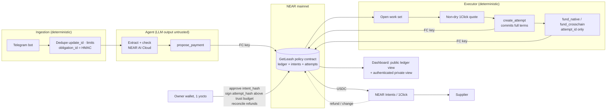

# GetLeash — Implementation Plan (v3, post-audit)

> Source of truth for this repository. Implementation notes and deliberate deviations are recorded in
> [`docs/decisions.md`](decisions.md); facts checked against live docs are in [`docs/verified-facts.md`](verified-facts.md).
>
> **2 Nov 2026: the contract follows decisions.md D-28 ("lean contract v2") wherever §3–§4 below differ.** To fit
> a ~1.5 NEAR mainnet budget, v2 keeps custody, allowlist, budgets, invoice dedupe, cooldown, executor-trust bound
> and pause on-chain, and moves the ledger, reconciliation, listings and term hashes off-chain. `docs/audit-response.md`
> maps every §9 row to its v2 defence and test.

**An AI agent that pays a business's suppliers across chains, under on-chain rules it cannot break.**
*Give your AI a wallet. Keep it on a leash.*

Website: **getleash.xyz** · Repo: `getleash` · NEAR accounts: `getleash.<you>.near`, `demo-getleash.<you>.near`

NEAR Hackathon · Development window 1–14 Nov 2026 (deadline **14 Nov, 23:59 UTC**) · Judging 16–18 Nov

Target tracks: `realworld` · `business` · `security` · `privacy` · `agents`

**The claim GetLeash makes (and only this claim):**
> GetLeash is self-custodial: each business's treasury is a contract controlled only by its own wallet, and GetLeash holds no key that can withdraw or redirect funds. It limits autonomous payments to authorized destinations and budgets, binds approvals to specific payment terms, and makes its remaining settlement trust dependencies explicit.

---

## 0. What changed in v3

v3 responds to an external design audit of v2 (findings F-01 to F-10). Every finding is accepted. One is accepted with a different fix: for F-01, owner signing for every cross-chain payment would remove the autonomy that is the point of the product. v3 instead caps executor trust with a small, explicit budget, and keeps owner signing for anything above it.

| Audit finding | v3 fix | Section |
|---|---|---|
| F-01 Executor can redirect cross-chain payments | Immutable execution **attempts**. The executor can only fund an attempt whose full terms are committed on-chain. Cross-chain attempts need an **owner signature on the attempt hash**, except inside a small daily **executor-trust budget**. Stretch: on-chain 1Click quote-signature check. | 4.1, 4.2 |
| F-02 Refund declarations restore capacity | No automatic cap restoration. Gross outgoing spend stays charged. Refunds are recorded only through owner-signed reconciliation with an amount, per attempt. Returned change is tracked separately from delivery. | 4.1 (ledger) |
| F-03 Approvals can change meaning | Immutable payment intent (supplier revision snapshot). `approve(id, intent_hash)`. Supplier changes invalidate open intents. Funding re-checks pause, supplier status and revision. | 4.1 |
| F-04 Inconsistent accounting | Internal ledger: `cash`, `reserved` (max input), `in_flight`, charges keyed by attempt and execution period. Checked arithmetic. The accounting core is a pure Rust module, tested with property tests. | 4.1 |
| F-05 Native amount mismatch | Separate `fund_native(attempt_id)`. The amount and recipient are derived from state only. | 4.1 |
| F-06 Agent controls the dedupe id | The obligation id is a keyed HMAC computed by deterministic ingestion code, never by the model. One open obligation per id; amendments need the owner. Compromised-host damage is bounded by the autonomous budget. | 4.3, 4.4 |
| F-07 Async lifecycle underspecified | Full attempt state machine, including `NeedsReconciliation`. Attempt-bound private callbacks. Cancel and expiry for unfunded approvals. Open-work view for workers. | 4.1, 4.2 |
| F-08 Storage exhaustion | Unauthorized callers panic before any write. Rejections are events plus a bounded ring buffer. On-chain quotas, input length limits, a cap on open payments, bounded pruning. | 4.1 |
| F-09 TEE badge unsupported | A verification policy, implemented in code, following NEAR AI's documented flow. Precise badge states; evidence retained. | 4.3 |
| F-10 Privacy overclaimed | Keyed commitments instead of guessable hashes. An authenticated dashboard for private data. No model-generated bytes on-chain. Honest claims about Telegram and the pipeline. | 5 |
| §3 Agent fraud within the numbers | An aggregate autonomous budget, a cumulative unverified-supplier budget, review triggers. The demo includes a fabricated *small* invoice to a *real* supplier. | 4.1, 8 |
| §4 Integration | Commit the quote, then register the deposit account. Non-dry quotes for execution. Explicit deposit, recipient and refund types. Fees taken from the actual quote. 1 yoctoNEAR on owner methods. Rotation by account swap. Clear cooldown semantics. Telegram `update_id` dedupe and input limits. | 4.x, 6 |

Telegram stays the hackathon channel. WhatsApp moves to post-hackathon behind the same channel interface.

**v3.1: self-custodial by design.** No full-access key on the policy contract; upgrades only through an owner-signed method. The business generates and authorizes every key. The executor-trust budget defaults to **0** in hosted mode, so a GetLeash-run server can never move funds to a destination the owner didn't approve. The full model is in §3.1.

---

## 1. The pitch in one paragraph

A small business sets its rules once: approved suppliers, which chain and asset each one is paid in, how much the AI may spend on its own per day, and what needs a human signature. An AI agent reads invoices forwarded to a Telegram bot, checks them with private inference on NEAR AI Cloud, and proposes payments. A NEAR smart contract decides. It pays only committed destinations, within budgets, on terms the owner has bound. Settlement runs cross-chain through NEAR Intents. The agent never holds the money, and no single off-chain component can redirect funds beyond a small, stated budget.

## 2. Goals and non-goals

**Goals**
- Working mainnet flow with small amounts. NEAR-native payouts are fully autonomous within budget. One cross-chain route (USDC NEAR → USDT Tron) is autonomous within the executor-trust budget and owner-signed above it.
- On-chain enforcement: allowlist, immutable intents, budgets (autonomous, daily, monthly, unverified-supplier, executor-trust), cooldown, fee bound, pause, quotas.
- Correct accounting under concurrency, failures and refunds, backed by property tests.
- Adversarial demo: prompt injection, address swap, and a fabricated small invoice to a real supplier. Each is shown with what stopped it, or how far it could get.
- Offline reproduction for the AI screener.

**Non-goals (stated in the README):** WhatsApp, fiat ramps, NGN invoices or FX, KYC, multi-tenant onboarding, automatic refund-based budget restoration, a second cross-chain route (Base is a stretch goal).

## 3. Architecture



### Accounts and keys

| Account | Holds funds? | Keys | Can call on `getleash…` |
|---|---|---|---|
| `getleash.<business>.near` | The business's USDC treasury plus NEAR for storage | **No full-access key** (deleted right after deploy, by the owner). Code changes only via owner-signed `upgrade`. | — |
| `<business>.near` (owner) | The business's own funds | Full access, in the **business's** wallet | All admin methods; each requires **1 yoctoNEAR**, so a wallet confirmation is forced |
| `agent-N.<business>.near` | Gas only | Function-call key → `propose_payment`. Created and authorized by the owner. | `propose_payment` |
| `executor-N.<business>.near` | Gas only | Function-call key → `create_attempt`, `register_deposit`, `fund_native`, `fund_crosschain`, `report_delivery`, `flag_reconciliation`. Created and authorized by the owner. | Those only |
| `demo-getleash.<you>.near` | About $5 of your own money | Separate contract, keys, database, inference budget and supplier set | Public "try to break it" panel |

**Rotation and recovery:** the contract stores `agent_id` and `executor_id`. To rotate a compromised or exhausted key, the owner creates `agent-(N+1)` and calls `rotate_agent(new_id)`. No recovery key on the old account is needed. A topped-up account balance does **not** refill a key allowance, so the monitor alerts early and rotation is the fix.

### 3.1 Custody model

**Principle:** GetLeash writes the software. The business holds every key that matters.

| Power | Who holds it |
|---|---|
| Withdraw, pause, change suppliers, change policy, approve, upgrade code, rotate keys, delete the contract | **Business owner wallet only** (1 yoctoNEAR confirmation each) |
| Propose payments | Agent function-call key. It can't move money; anything it proposes still goes through the contract rules. |
| Fund committed attempts | Executor function-call key. It can only pay destinations already bound in the contract. |
| Anything at all on behalf of GetLeash the company | **Nothing.** GetLeash holds no key on any customer account. |

**Setup flow** (run from the business's wallet; GetLeash never sees a private key):
1. The owner creates `getleash.<business>.near` and deploys the audited contract wasm, whose hash is published in the repo. In the same signed transaction batch, `new(owner_id, …)` initializes it and the account's full-access key is deleted.
2. The agent and executor services generate their keypairs **locally**, on whichever machine runs them, and show only the public keys.
3. The owner signs the transactions that create `agent-1` and `executor-1` and add those public keys as function-call keys, scoped to the policy contract and the listed methods.
4. The owner funds the treasury with `ft_transfer_call`.
5. The owner can exit at any time: `withdraw` everything to their own account. A delete option is available too.

**Two ways to run the agent and executor:**

| Mode | Who runs the services | `executor_trust_daily_budget` | What a compromised server can do |
|---|---|---|---|
| **Self-hosted** (Docker Compose on the business's machine) | The business | The owner may raise it above 0 for automatic small cross-chain payments | Same bound as before, but the business is trusting its own machine |
| **Hosted by GetLeash** | GetLeash, as a convenience | **0, enforced by the contract.** The policy has a `hosted_mode` flag set at init; while it's true, `set_policy` refuses a non-zero trust budget. | Propose payments to **already-approved suppliers** within the autonomous budget, and fund attempts the owner already signed. It can **never** send funds to a new destination. |

Native payouts to allowlisted NEAR suppliers stay fully automatic in both modes, because their destination is fixed in the contract.

**Upgrades without a full-access key:** `upgrade(code)` is an owner-only, 1-yocto method. It deploys new code and calls `migrate()`. The wasm hash must be published in the repo before the owner signs. GetLeash can propose upgrades; only the owner can apply them.

**What custody we still rely on, stated plainly:**
- During a cross-chain swap, funds sit briefly with NEAR Intents and 1Click.
- USDC itself is issued by Circle, which can freeze tokens.
- Off-chain data in hosted mode (invoices, supplier names) is stored by GetLeash. That's data, not funds.

For the hackathon, *you* are the "business": your wallet is the owner and the money is yours. The setup script follows the flow above exactly, so the demo is the real self-custodial path.

## 4. Component specs

### 4.1 Policy contract (Rust, `near-sdk` 5.x)

Structure the code as **`ledger.rs` (pure accounting, no `env` calls)** plus `contract.rs` (auth, I/O, promises). The pure module is what the property tests target.

#### 4.1.1 Core objects

```rust
struct Supplier {
  revision: u32,          // increments on any change to chain/asset/recipient/caps
  chain: Chain,           // enum: Near | Tron   (Base = stretch)
  asset: AssetId,         // validated against an owner-maintained asset list
  recipient: String,      // length-limited, format-checked off-chain before add
  per_payment_cap: u128, monthly_cap: u128,
  changed_at: u64, verified: bool, active: bool,
}

// Immutable once created. Approvals bind to its hash.
struct Intent {
  id: u64,
  obligation_id: [u8; 32],      // keyed HMAC from ingestion (4.4)
  supplier_id: SupplierId,
  supplier_revision: u32,
  chain: Chain, asset: AssetId, recipient: String,   // snapshot
  amount_out: u128,             // what the supplier must receive (dest units)
  max_in: u128,                 // amount_out-based bound × (1 + max_fee_bps); reserved in full
  created_at: u64, expires_at: u64,
  route: Route,                 // Autonomous | NeedsApproval(reason)
  status: IntentStatus,         // Pending | Approved | Funding | Done | Cancelled | Invalidated | Expired
  intent_hash: [u8; 32],        // sha256 of borsh(all fields above except status)
}

// One funding try for an intent. Terms are immutable.
struct Attempt {
  id: u64, intent_id: u64,
  kind: AttemptKind,            // Native | CrossChain
  deposit_address: Option<String>,   // cross-chain only
  amount_in: u128,              // native: == amount_out (derived); cross-chain: from the quote, ≤ max_in
  quote_deadline: Option<u64>,
  deposit_type: DepositType,    // ORIGIN_CHAIN
  recipient_type: RecipientType,// DESTINATION_CHAIN
  refund_type: RefundType,      // ORIGIN_CHAIN, refund_to = this contract
  quote_ref: Option<String>,    // quote id/signature, for audit and the stretch verifier
  attempt_hash: [u8; 32],
  authorization: AttemptAuth,   // TrustBudget | OwnerSigned | NativeAuto
  status: AttemptStatus,
  charged_at: Option<u64>,      // execution timestamp for period accounting
  delivered_amount: Option<u128>, dest_tx: Option<String>,
  refunded_amount: u128,        // only via owner reconciliation
}
```

#### 4.1.2 Attempt lifecycle

```
Created ──(cross-chain, above trust budget)──▶ AwaitingOwner ──sign(attempt_hash)──▶ Authorized
Created ──(native, or within trust budget)──────────────────────────────────────────▶ Authorized
Authorized ──fund_*──▶ FundingPending ──callback ok──▶ Funded ──report_delivery──▶ Delivered
                                      └─callback err─▶ Failed (ledger restored once)
Funded / FundingPending with unknown outcome ──▶ NeedsReconciliation (no automatic refund)
Created / AwaitingOwner / Authorized ──expire (quote_deadline) or cancel──▶ Void
```

- **At most one live attempt per intent.** A new attempt is allowed only after the previous one is `Failed` or `Void`, or after an owner reconciles a refund. Retries reuse the same intent and obligation id; they never mint a new invoice identity.
- **Callbacks** are `#[private]`, take `attempt_id`, and are no-ops unless the attempt is still `FundingPending` with that id. A stale callback cannot change a later attempt.
- **A callback failing does not roll back a transfer that succeeded.** If the transfer result can't be determined, the attempt goes to `NeedsReconciliation`. A timeout is never treated as permission to pay again.

#### 4.1.3 Ledger (pure module)

| Quantity | Meaning | Changes on |
|---|---|---|
| `cash` | USDC the contract has recognized | +`ft_on_transfer` from USDC (top-ups); +owner `reconcile_inflow(amount, attribution)`; −at funding; +on proven transfer failure |
| `reserved` | Σ `max_in` of Approved and unfunded intents | +approve/auto-approve; −at funding (the full `max_in` is released and the actual `amount_in` leaves `cash`); −cancel/expire/invalidate |
| `in_flight` | Σ `amount_in` of `FundingPending` and `Funded` attempts | +funding; −delivered or failed |
| `charges` | `(attempt_id, period_day, period_month, amount_in)` | Recorded at funding with the execution timestamp. Never removed by refunds. Removed only on proven transfer failure, for that exact attempt. |

**Invariants** (checked after every mutation, with checked arithmetic and no saturating subtraction):
- `reserved ≤ cash`. Unfunded commitments always fit within recognized funds.
- Each attempt funds at most once.
- Every debit equals the attempt's committed `amount_in`, to its committed destination.
- No refund credits more than the owner-reconciled amount, and each attempt's refund is credited once.
- Every charge belongs to exactly one attempt and one period.

**Available to spend:** `cash − reserved`. `in_flight` is already out of `cash`, so nothing is subtracted twice (fixes F-04A).
**External balance:** the contract does *not* treat the live USDC balance as authority. The owner method `reconcile_inflow` handles plain `ft_transfer` arrivals, refunds and returned change, with a stated attribution: a top-up, an attempt refund with its `attempt_id`, or unattributed. The dashboard shows the live balance minus `cash` as **"unreconciled inflow"**.

#### 4.1.4 Budgets and rules

```rust
struct Policy {
  autonomous_daily_budget: u128,      // total auto-approved per day (keep small, e.g. $50)
  approval_threshold: u128,           // per payment; above → NeedsApproval
  daily_cap: u128, monthly_cap: u128, // absolute ceilings, counting owner-approved payments too
  executor_trust_daily_budget: u128,  // cross-chain funding without an owner-signed attempt. Default 0; forced 0 while hosted_mode
  hosted_mode: bool,                  // set at init; only the owner can turn it off (switching to self-hosted)
  unverified_cumulative_budget: u128, // total to unverified suppliers, ever, until verified
  test_payment_max: u128,             // e.g. $0.50, allowed during cooldown with an owner signature
  max_fee_bps: u16,
  new_supplier_cooldown_ns: u64,
  intent_ttl_ns: u64,                 // unfunded approvals expire (e.g. 72h)
  max_open_intents: u32,              // e.g. 50
  max_proposals_per_day: u32,         // e.g. 100
}
```

**`propose_payment(obligation_id, supplier_id, amount_out)`** (agent):
1. **Panic before any write** if the caller isn't the agent (fixes F-08).
2. Quota checks: proposals today and open intents. A breach panics, with no write.
3. Rule checks. A failure emits an event and writes to a **bounded ring buffer** (last 100 rejections) with an **enum reason code** only. There's no free text from the model.
   - `PAUSED`, `UNKNOWN_SUPPLIER`, `INACTIVE_SUPPLIER`
   - `OBLIGATION_OPEN_OR_PAID`: an obligation id with a live or done intent. Amendments go through owner `amend_intent`.
   - `SUPPLIER_COOLDOWN`
   - `OVER_UNVERIFIED_BUDGET`: cumulative to this unverified supplier.
   - `OVER_PER_PAYMENT_CAP`, `OVER_MONTHLY_SUPPLIER_CAP`, `OVER_DAILY_CAP`, `OVER_MONTHLY_CAP`
   - `INSUFFICIENT_FUNDS`: `max_in > cash − reserved`.
4. On pass, create an `Intent` with a snapshot of the supplier and revision. Route it:
   - **Autonomous** if `amount_out ≤ approval_threshold`, it fits in today's `autonomous_daily_budget`, the supplier is verified, and there are no review flags. Then auto-approve and reserve `max_in`.
   - **NeedsApproval** otherwise: Pending, with the reason recorded (`ABOVE_THRESHOLD`, `AUTONOMOUS_BUDGET_USED`, `UNVERIFIED_SUPPLIER`, `REVIEW_FLAG`).
   - `review_flag: Option<ReviewFlag>` is an enum the agent can set (`AddressMismatch`, `UncertainMatch`, `AmbiguousExtraction`, `UnusualAmount`). Setting a flag forces review; the agent can never use it to skip review.

**Owner methods** (all `#[payable]`, `assert_one_yocto` + owner check):
- `approve(intent_id, expected_intent_hash)`: hash must match; re-runs the checks; reserves `max_in`.
- `reject(intent_id)`, `cancel(intent_id)`.
- `authorize_attempt(attempt_id, expected_attempt_hash)`: for cross-chain attempts above the trust budget, or test payments.
- `reconcile_inflow(amount, attribution)`, `resolve_reconciliation(attempt_id, outcome, delivered, refunded)`.
- `add_supplier`, `update_supplier` (bumps `revision`, resets `changed_at` and `verified`, and **invalidates every open intent for that supplier**), `verify_supplier`, `deactivate_supplier`.
- `set_policy` (refuses a non-zero trust budget while `hosted_mode`), `pause`, `unpause`, `withdraw`, `rotate_agent`, `rotate_executor`, `amend_intent`.
- `upgrade(code)`: deploys new code, then calls `migrate()`. The only way to change the code, since the account has no full-access key.

**Executor methods:**
- `create_attempt_native(intent_id)`: the amount and recipient come from the intent.
- `create_attempt_crosschain(intent_id, deposit_address, amount_in, quote_deadline, quote_ref)`: checks `amount_in ≤ intent.max_in`, the deadline is in the future plus a margin, the types are fixed, and the intent is Approved with no live attempt. If `amount_in` fits in today's `executor_trust_daily_budget`, it's authorized as `TrustBudget`; otherwise it goes to `AwaitingOwner`.
- `register_deposit(attempt_id)`: storage-deposits the **committed** deposit account on USDC (fixes the register-before-commit gap). Bounded per day.
- `fund_native(attempt_id)` / `fund_crosschain(attempt_id)`: **no amount or address parameters.** Re-checks pause, supplier active, supplier revision equals the snapshot, and the quote deadline. Moves the ledger atomically, then calls USDC `ft_transfer` **attaching 1 yoctoNEAR** from the contract, with an attempt-bound callback.
- `report_delivery(attempt_id, delivered_amount, dest_tx)`: informational for cross-chain; it records delivery but **does not credit funds or restore budget**.
- `flag_reconciliation(attempt_id)`: moves the attempt to `NeedsReconciliation`.

**Pause semantics:** pause blocks proposals, approvals, attempt creation and funding. Callbacks, reconciliation and views keep working. Funds already in settlement can't be recalled. The README says so.

**Cooldown and verification (one consistent rule):**
- During the cooldown, the only payment allowed to that supplier is a **test payment** of at most `test_payment_max`, which needs an owner-signed attempt.
- The supplier confirms receipt over a **previously established contact channel**, not one named on the new invoice. The owner then signs `verify_supplier`.
- Verification does **not** end the cooldown. Larger payments need **both** an elapsed cooldown **and** verified status.
- The demo shows exactly this.

**Views:** `get_policy`, `get_supplier(id)`, `get_intent(id)`, `get_attempt(id)`, `get_open_work()` (a bounded list of non-terminal intents and attempts, so workers revisit old Pending items), `get_ledger()`, `get_recent_rejections()`, `get_budgets_today()`.

### 4.2 Executor (TypeScript, deterministic, no LLM)

Loop over `get_open_work()`, not a forward-only cursor:
1. **Approved intent, no live attempt:**
   - Native → `create_attempt_native` → `fund_native`.
   - Cross-chain → request a **non-dry** exact-output 1Click quote (`dry: true` quotes have no deposit address or deadline and are only for previews) with `depositType=ORIGIN_CHAIN`, `recipientType=DESTINATION_CHAIN`, `refundType=ORIGIN_CHAIN`, `recipient` = the **intent's snapshot**, and `refundTo` = the contract.
   - Verify the quote signature with the 1Click SDK verifier, as a sanity check only; the real protection is on-chain.
   - Check the quoted input ≤ `max_in`. Then call `create_attempt_crosschain` → `register_deposit` → (owner signs if above the trust budget) → `fund_crosschain` → submit the deposit tx hash to 1Click.
2. **Attempt `AwaitingOwner`:** notify the owner on Telegram with a link to `/attempt/<id>`. If the quote deadline passes, the attempt goes `Void`, and the executor re-quotes into a new attempt for the same intent.
3. **Attempt `Funded`:** poll 1Click status → `report_delivery`. Report refunds or returned change to the owner for `reconcile_inflow`. **The executor never credits funds.**
4. **Unknown outcome** (lost response, provider down past a timeout) → `flag_reconciliation`. Never re-fund.
5. Persist a local journal for convenience, but the **contract is the source of truth**. On restart, rebuild from `get_open_work()`.
6. Fees come from the actual quote. Don't hard-code a fee: the audit notes the docs list an extra unauthenticated fee beyond the 0.2% in the hackathon FAQ. Register for a 1Click JWT on day 1 to get the authenticated schedule.
7. `--mock` mode runs against `mock-1click`, which can produce signed quotes, delays, partial refunds, change-return and provider outages.

**Trust statement for the README:**
- **Native payouts:** fully contract-enforced.
- **Cross-chain payouts:** the contract binds the destination it was told about. In hosted mode the trust budget is 0, so every cross-chain attempt is owner-signed after the approval page independently fetches and checks the quote. In self-hosted mode, the owner may allow a small `executor_trust_daily_budget`; within it, a stolen executor key on the business's own machine could redirect up to that budget.
- **Settlement:** delivery depends on NEAR Intents and 1Click infrastructure.
- **Stretch:** verify 1Click quote signatures on-chain (`env::ed25519_verify` over the documented serialization, with a configured signer key and replay protection by quote id). This would remove executor trust for cross-chain payments.

### 4.3 Agent (TypeScript, LLM via NEAR AI Cloud)

1. **Receive** an `InvoiceInput` from ingestion. It already has a deduped `update_id`, size-limited files and a computed `obligation_id`.
2. **Extract** with a strict JSON schema validated by zod. Cross-check the amounts against the raw text. OCR runs first if needed, with page, size and runtime limits.
3. **Currency gate:** USD, USDT or USDC only.
4. **Match** the supplier from the off-chain directory. If the match is uncertain, set `review_flag = UncertainMatch`.
5. **Mismatch check:** payment details on the invoice ≠ the address on file → `AddressMismatch`, and alert the owner.
6. **History check:** an unusual amount → `UnusualAmount`.
7. **Propose** with `obligation_id` (from ingestion), `supplier_id`, `amount_out` and an optional `review_flag`. The model produces no other bytes that go on-chain.

**TEE verification policy (fixes F-09):**
- Implement NEAR AI's documented verification flow: preflight attestation checks (freshness, accepted measurements, signer identity) and **response-signature binding** to the exact request and response.
- Gateway evidence and model evidence are distinguished, as the docs describe.
- Badge states, computed only by verification code: `Model response verified` · `Gateway evidence verified` · `Verification unavailable` · `Verification failed`. The evidence bundle is stored with the invoice record.
- The README states that attestation proves *where* the inference ran. It doesn't prove the invoice is genuine or the reasoning is right.
- If full verification doesn't land by day 9, ship `Verification unavailable` honestly rather than a false tick.

### 4.4 Ingestion and Telegram bot (grammY)

- **Durable dedupe on `update_id`** before any processing.
- **Allowlist** of approved users **and approved chats**. Sensitive replies only go to approved chats.
- **Limits:** file ≤ 10 MB, PDF ≤ 10 pages, image ≤ 4000 px, OCR ≤ 30 s, concurrent jobs ≤ 3.
- **`obligation_id = HMAC-SHA256(tenant_secret, supplier_id ‖ normalised_invoice_number)`**. It's computed by ingestion code after supplier matching, from the extracted invoice number, normalised deterministically (case, spaces, leading zeros). It's stable across PDF, photo and text versions of the same invoice, and not guessable without `tenant_secret`. If there's no reliable invoice number, the owner must confirm before proposing.
- **Honest threat note:** if the host running ingestion and the agent is compromised, it can mint obligation ids. That's bounded by the autonomous, unverified and executor-trust budgets, and stated in the threat model.
- **Commands:** `/status`, `/pending`, `/suppliers`, `/pause` (opens the signing page).
- **Approval links:** `/approve/<intent_id>` and `/attempt/<attempt_id>` on the dashboard.
- **Channel interface:** `receive(update) → InvoiceInput` and `send(chatId, Notice)`, ready for WhatsApp later.

### 4.5 Dashboard (Next.js, hosted on Vercel)

- **Public view** (chain data only): ledger (`cash`, `reserved`, `in_flight`, unreconciled inflow), budgets used today, intents and attempts by pseudonymous supplier id, recent rejections with reason codes, explorer links, verification badges.
- **Private view:** the owner signs in with a NEAR wallet message signature (NEP-413). It adds supplier names, invoice documents and extracted details. Every private endpoint checks the session.
- **Approval page `/approve/<id>`:** loads the intent from the chain, shows the snapshot destination, amount and max input, and the owner signs `approve(id, intent_hash)` with 1 yoctoNEAR.
- **Attempt page `/attempt/<id>`:** loads the attempt from the chain and **independently** fetches the 1Click quote status for its deposit address. It shows quote, recipient, refund type and amounts side by side and flags any mismatch in red. The owner signs `authorize_attempt(id, attempt_hash)`.
- **Reconcile page:** unreconciled inflows → the owner attributes each to an attempt or a top-up.
- **"Try to break it"** runs against `demo-getleash`, with a separate backend, IP rate limits and an LLM spend cap.

### 4.6 MCP server (stretch)

`submit_invoice`, `list_intents` and `get_policy`, behind the same ingestion and contract rules.

## 5. Privacy: what's protected and what isn't

| Data | Where | Protection | Not protected against |
|---|---|---|---|
| Invoice files and contents | Telegram → bot → OCR → inference → encrypted store | Encrypted at rest; inference in a TEE (verified per policy) | Telegram cloud chats are not end-to-end encrypted; a compromise of the running bot process (which holds the key) |
| Supplier names and contacts | Off-chain directory | Shown only in the authenticated private view | Server compromise |
| Obligation identity | On-chain keyed HMAC | Not guessable without `tenant_secret` | Leak of `tenant_secret` |
| Amounts, destination addresses, timing | On-chain | **Public** | Anyone; stated plainly |
| Rejection reasons | On-chain enum codes | No model text on-chain, so no exfiltration channel | — |

## 5.1 Build tooling: NEAR agent skills

Install once at the repo root: `npx skills add near/agent-skills`. These skills guide the coding agent; they don't replace this plan.

| Skill | Used for | Plan sections |
|---|---|---|
| `near-smart-contracts` | Rust contract: state, storage, cross-contract calls, callbacks, security patterns | 4.1 |
| `near-intents` | 1Click quotes, deposit submit, status polling, quote types | 4.2 |
| `near-ai-cloud` | Private inference, TEE attestation and NRAS verification, the badge policy | 4.3 |
| `near-api-js` | Executor, agent and setup scripts: transactions, function-call keys, FT calls | 4.2, 4.3, 3.1 |
| `near-dapp` | Next.js dashboard, wallet integration, approval and attempt signing pages | 4.5 |
| `near-kit` | Optional: type-safe contract bindings and sandbox tests for the TS services | 4.2, 9 |

**Rules for the coding agent** (put these in `AGENTS.md` / `CLAUDE.md` at the repo root):
1. **This plan and `docs/audit-response.md` win over skill examples.** Skills show generic patterns; GetLeash has stricter rules.
2. **Watch for these conflicts in particular:**
   - Executions use **non-dry** quotes with explicit `depositType`, `recipientType` and `refundType`. `dry: true` is for previews only.
   - Executor methods never take free amounts or addresses at funding time.
   - Owner methods require 1 yoctoNEAR.
   - No full-access key on the policy contract.
   - Refunds never restore budget automatically.
3. **Pick one TypeScript NEAR SDK and stick to it.** Use `near-api-js` (it matches the wallet and dApp guidance). Only switch the services to `near-kit` if its sandbox testing clearly saves time; never mix both in the same service.
4. **Contract tests stay in Rust** (`near-workspaces` + `proptest` on `ledger.rs`).
5. **Verify anything a skill states about endpoints, field names, asset ids or the USDC address against the live docs** and record it in `docs/verified-facts.md`. Skills can lag the docs.

The README lists the skills under "Tools and AI assistance", as the hackathon rules ask for libraries and AI-generated code to be disclosed.

## 6. Repository layout

```
getleash/
├── contract/
│   ├── src/ledger.rs        # pure accounting core (proptest target)
│   ├── src/contract.rs      # auth, rules, intents, attempts, promises
│   └── tests/               # near-workspaces integration + adversarial suite
├── executor/                # open-work loop, 1Click client, journal, --mock
├── agent/                   # extract, match, flags, propose, TEE verification
├── ingestion/               # update_id dedupe, limits, obligation_id HMAC
├── channels/{core,telegram}/
├── web/                     # public view, private view (NEP-413), approve, attempt, reconcile, demo panel
├── mock-1click/             # signed quotes, delays, partial refunds, change, outages
├── scripts/                 # deploy, add-keys, rotate, seed, check-allowances, demo
├── fixtures/invoices/       # clean, dup (pdf/photo/text), edited-dup, poisoned, address-swap, small-fabricated, NGN
├── docs/{threat-model,runbook,audit-response,verified-facts}.md
├── .agents/skills/          # near/agent-skills (installed via npx skills add)
├── AGENTS.md / CLAUDE.md    # coding-agent rules from §5.1
├── .env.example · LICENSE (MIT) · README.md
```

## 7. Day-by-day plan (reordered per the audit)

| Day | Date | Deliverables |
|---|---|---|
| 1 | Sun 1 Nov | Repo, `npx skills add near/agent-skills`, `AGENTS.md` rules, accounts, Telegram bot, NEAR AI key, **1Click JWT registration**. Read 1Click quote and signature docs and NEAR AI verification docs; record field names and types in `docs/`. |
| 2 | Mon 2 Nov | **`ledger.rs` + proptest**: cash, reserved, in-flight, charges, invariants. This is the foundation; it isn't skipped. |
| 3 | Tue 3 Nov | Suppliers with revisions, intents with snapshot and hash, `propose_payment` (panic-first auth, quotas, ring buffer), routing, budgets, cooldown and test-payment rule. |
| 4 | Wed 4 Nov | Attempts lifecycle, `fund_native` with an attempt-bound callback, cancel and expiry, `get_open_work`, owner methods with 1 yocto, rotation, `upgrade` and `migrate`, `hosted_mode`. Self-custodial setup script (deploy + init + delete full-access key in one batch; local keygen; owner adds the function-call keys). Testnet deploy. Function-call keys proven restricted. |
| 5 | Thu 5 Nov | **Native payouts end to end on testnet**, then mainnet ($1). Adversarial tests for the native path (audit table rows). |
| 6 | Fri 6 Nov | Cross-chain: non-dry quotes, `create_attempt_crosschain`, `register_deposit`, trust budget vs owner-signed, `fund_crosschain`. mock-1click scenarios. |
| 7 | Sat 7 Nov | **First real cross-chain payment** (USDC → USDT Tron, $2). Delivery reporting, owner reconciliation of change and refunds. **Cut rule:** if this isn't working, ship native plus Tron owner-signed only. |
| 8 | Sun 8 Nov | Ingestion: dedupe, limits, obligation HMAC. Agent: extraction, matching, flags, propose. |
| 9 | Mon 9 Nov | TEE verification policy and badge states. Telegram commands and notifications. |
| 10 | Tue 10 Nov | End to end on mainnet. Run every fixture. Full adversarial suite green. |
| 11 | Wed 11 Nov | Dashboard: public view, NEP-413 private view, approve, attempt and reconcile pages. |
| 12 | Thu 12 Nov | `demo-getleash` with an isolated backend and the demo panel. Threat model, runbook, audit-response doc. |
| 13 | Fri 13 Nov | README for the AI screener; fresh-clone offline reproduction; record the demo; draft the X post. |
| 14 | Sat 14 Nov | Freeze, make the repo public, post, submit well before 23:59 UTC. |

Stretch, only if day 12 is green: the on-chain quote verifier, MCP server, Base route.

## 8. Demo script (90 seconds)

1. **(0–10s) Problem.** "A Lagos importer pays suppliers across Tron and NEAR. Manual, slow, and invoice fraud is everywhere. What if an AI paid them, and couldn't steal?"
2. **(10–30s) Happy path.** Forward an invoice → parsed → "Model response verified" → paid automatically within the budget → Tron explorer shows the exact USDT received. (The demo runs in self-hosted mode on your own machine, with a small trust budget. Mention in one line that in hosted mode this tap goes to the owner.)
3. **(30–45s) Prompt injection.** A poisoned invoice tries to pay an unknown address. There's no field to put an address in; the contract rejects it with `UNKNOWN_SUPPLIER`.
4. **(45–60s) Address swap.** The invoice shows a new wallet → `AddressMismatch` review. Even after the owner updates the supplier, only a $0.50 owner-signed test payment is possible during the cooldown.
5. **(60–75s) The honest one.** A fabricated small invoice to a **real** supplier is paid, because it's within the rules. But the autonomous budget caps how much this can ever cost per day, and the owner sees it immediately. "We don't claim the AI can't be fooled. We claim exactly how much it can cost you."
6. **(75–90s) Why NEAR.** Function-call keys, Intents settlement, verified private inference, and an audited design (show `audit-response.md`). Repo and live demo links.

## 9. Required tests

Unit and integration tests cover every reason code and owner method. On top of that, the **adversarial suite** from the audit, all required green before submission:

| Test | Required result |
|---|---|
| Executor supplies its own deposit address above the trust budget | Attempt `AwaitingOwner`; funding impossible without the owner's signature |
| Executor funds its own address within the trust budget | Bounded by `executor_trust_daily_budget`; documented as accepted risk |
| Quote reused for another intent or attempt | Rejected (one live attempt per intent; `quote_ref` uniqueness) |
| Executor claims a refund | No credit, no budget restoration |
| Unrelated top-up during refund processing | Unreconciled until the owner attributes it |
| Exact-output swap returns change | Delivered and returned amounts recorded separately |
| Refund for an October attempt arrives in November | November charges unchanged |
| Approve, then pause or deactivate the supplier | Funding blocked |
| Supplier changed after approval | Open intents invalidated; the old approval can't pay the new address |
| 60 of 100 in flight | `available = cash − reserved`, no double subtraction |
| Concurrent approvals with fee headroom | Σ `max_in` ≤ `cash` always |
| Native funding | Debit equals `amount_out`; no caller-supplied amount exists |
| Same invoice, different hash or edited fields | Same `obligation_id` → `OBLIGATION_OPEN_OR_PAID` |
| Transfer succeeds, callback fails | No automatic re-fund; `NeedsReconciliation` |
| Worker restart after broadcast | Recovered from `get_open_work`; no duplicate transfer |
| Unauthorized callers spam proposals | Panic before writing; storage unchanged |
| Authorized agent spams | Quotas hit; ring buffer bounded |
| Unexecutable approved intent | Expires; releases only the unfunded reservation |
| Stale callback after a new attempt | No effect |
| Attestation stale, invalid or missing | No "verified" badge |
| Telegram update replayed | One obligation |
| Demo panel requests production data | Denied (separate backend) |
| Policy contract account after setup | No full-access key exists (checked with a view of the account's access keys) |
| `set_policy` with a non-zero trust budget while `hosted_mode` | Rejected |
| Non-owner calls `upgrade` or `withdraw` | Rejected; owner calls without 1 yocto also rejected |

**Property tests (`proptest` on `ledger.rs`):** random sequences of top-ups, proposals, approvals, policy changes, attempt creation, funding, callbacks in any order, failures, reconciliations and time advancement. Assert all the invariants in 4.1.3 after every step.

## 10. README and submission checklist

- [ ] The one-sentence claim from the top of this plan, nothing stronger.
- [ ] Architecture, accounts and keys, **trust statement**, privacy table, threat model.
- [ ] `docs/audit-response.md`: each audit finding → fix → test name. Strong for the security track.
- [ ] Quick verify: mainnet contract, native and Tron payouts, blocked injection, cooldown rejection, fabricated-small-invoice case, dashboard.
- [ ] Offline reproduction: `pnpm i` → `cargo test` (including proptest) → `pnpm demo:mock`, with "do X → see Y" for each fixture.
- [ ] Reused code disclosed, including near/agent-skills and AI coding assistance; MIT license; `.env.example`; no secrets.
- [ ] Repo public and tagged; hosted demo up until 25 Nov; allowance monitor on; X post with the video; form submitted once.

## 11. Budget (mainnet)

| Item | Estimate |
|---|---|
| USDC for tests and demo, including fees, refunds and test payments | $30–50 |
| `demo-getleash` treasury | $5 |
| NEAR for storage, accounts and gas | 6–10 NEAR |
| NEAR AI Cloud inference | $10 credit, then pay as you go |
| Hosting | Free tier to about $10 |

## 12. Risks and mitigations

| Risk | Mitigation |
|---|---|
| The redesign adds work to a two-week window | Ledger first (day 2) and native first (day 5) means a safe, demoable core exists even if cross-chain slips. Base, MCP and the quote verifier are cut first. |
| 1Click quote fields or types differ from assumptions | Verified on day 1 and recorded in `docs/`; mock-1click mirrors the real schema. |
| Owner signing makes cross-chain feel less autonomous | The trust budget keeps small payments autonomous. The demo explains the trade-off as a feature. |
| TEE verification flow is complex | Honest badge states; "unavailable" beats a false tick. |
| Accounting bugs | Pure ledger module plus property tests before any I/O code. |
| Screener can't reproduce | Offline mock path; fresh-clone test on day 13. |

## 13. Stretch goals (after day 12 only)

1. On-chain 1Click quote-signature verification, which removes the executor-trust budget.
2. MCP server and an Agent Market listing.
3. USDC → Base route.
4. Factory contract so a business can create its GetLeash account in one wallet-signed step from getleash.xyz.
5. Rhea yield on idle `cash` (with ledger support).
6. WhatsApp adapter; NGN invoices with FX; multi-tenant factory.
